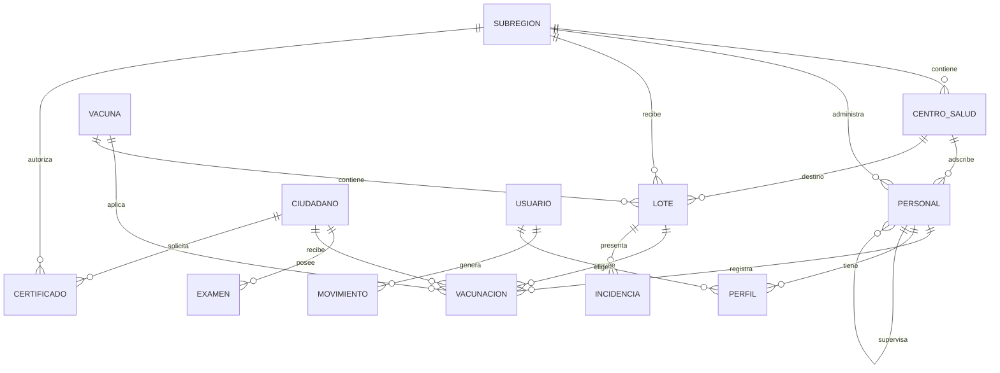

# Modelo de datos preliminar

Última actualización: 2026-10-25
Estado: **boceto**. No es un modelo relacional definitivo.

> **Este documento no define la base de datos.** Recoge lo que los dibujos a mano mencionan, más lo mínimo que
> las pantallas necesitan para funcionar. El esquema real todavía no existe y **manda sobre este archivo**.
> Nada en el código debe depender de estos nombres: son una hipótesis de trabajo para poder maquetar.
>
> Regla: si un campo no está dibujado ni es imprescindible para una vista ya bocetada, se marca como
> _por confirmar_ y no se implementa. Las decisiones ya tomadas están en `docs/diseno/vistas.md` §10 y aquí
> aparecen como `confirmado`.

## 1. Cómo leer las tablas de campos

Cada campo lleva tres datos:

- **Origen**: qué imagen lo dibuja (`datos-roles`, `datos-usuarios`, `diagrama-*`) o `deducido`.
- **Estado**:
  - `esbozado` — escrito literalmente en un boceto.
  - `deducido` — no está dibujado, pero la vista o la relación lo exige.
  - `confirmado` — decisión ya registrada en `vistas.md` §10.
  - `por confirmar` — decisión pendiente con el equipo de base de datos.
- **Nota**: ambigüedad, restricción o pregunta asociada.

Los tipos son tentativos (`text`, `uuid`, `date`, `boolean`, `enum`, `fk`, `jsonb`) y solo orientan.

## 2. Convenciones detectadas en los bocetos

- **Nombres**: `N1`, `N2` (nombres) y `A1`, `A2` (apellidos). Se mantiene la separación porque los bocetos la
  dibujan explícitamente; el nombre completo se compone al mostrar.
- **Cédula** como identificador natural del ciudadano y del personal. No hay campo `id` dibujado en ninguna ficha.
  Queda abierto si la base de datos usa clave sustituta (pregunta 1 de la sección 8).
- **ID-Ente**: el personal pertenece a una subregión o a un centro. Se modela como par
  (`ente_tipo`, `ente_id`) o con dos claves foráneas opcionales.
- **Número profesional** y **profesión**: el número identifica al profesional sanitario; la profesión es catálogo.
- **Snake case**: `Grado_Instruccion` es el único campo escrito en snake case. En TypeScript se usará camelCase;
  en SQL, snake case.
- **"Cargamento" y "lote"** se usan como sinónimos en los dibujos (sidebar y control de vacunas).
- **Roles**: se persisten como `0`–`3`. El `0` es el ciudadano y no tiene cuenta.
- **Credenciales**: correo y contraseña para todos los roles internos; el master además tiene nombre de usuario. Los
  roles 2 y 3 validan la cuenta de la entidad y luego el perfil de trabajo (decisión 15).

## 3. Diagrama preliminar



Relaciones que el dibujo **no** aclara y quedan como hipótesis:

- `PERFIL` es el **perfil de trabajo con credenciales propias** que se elige tras validar la cuenta de la entidad.
  Aplica a los roles 2 y 3 (decisión 15); la jerarquía jefe → trabajador se modela con `personal.jefe_id`
  (decisión 3).
- `CERTIFICADO` toma exámenes y vacunas: la relación puede ser por consulta (snapshot) o por referencia viva.
  Se recomienda snapshot para que el certificado no cambie después de emitido.
- `INCIDENCIA` cuelga de `LOTE` según el diagrama de autoridades ("incidencias de vacunas → alergias, estado de
  lotes"), pero "alergias" sugiere un evento adverso sobre el ciudadano. Ver sección 6.

## 4. Entidades

### 4.1 `usuario` — cuenta de acceso

Solo para roles 1, 2 y 3. El ciudadano no tiene cuenta. En los roles 2 y 3 esta tabla representa la cuenta de la
entidad; el perfil de trabajo se valida en un segundo paso (decisión 15).

| Campo            | Tipo tentativo | Origen                        | Estado        | Nota                                                               |
| ---------------- | -------------- | ----------------------------- | ------------- | ------------------------------------------------------------------ |
| `id`             | uuid           | deducido                      | por confirmar | Clave sustituta                                                    |
| `nombre_usuario` | text (único)   | decisión 4                    | confirmado    | Solo el master lo tiene dibujado; define el login del master       |
| `correo`         | text (único)   | `datos-roles` (Master)        | esbozado      | Login del master y de la cuenta de la entidad                      |
| `clave_hash`     | text           | `datos-roles` (Master)        | confirmado    | El personal también tiene contraseña (decisiones 4 y 15)           |
| `rol`            | smallint 0–3   | `diagrama-1`                  | confirmado    | Se persiste 0–3; el 0 no tiene cuenta                              |
| `perfil_id`      | fk `perfil`    | decisión 15                   | por confirmar | Nulo en el master; obligatorio en los roles 2 y 3 tras el 2.º paso |
| `activo`         | boolean        | deducido ("usuarios activos") | deducido      | El master lista usuarios activos                                   |
| `personal_id`    | fk `personal`  | deducido                      | por confirmar | Enlaza cuenta con ficha de empleado                                |
| `creado_por`     | fk `usuario`   | deducido                      | por confirmar | El master crea usuarios                                            |
| `creado_en`      | timestamp      | deducido                      | por confirmar |                                                                    |
| `ultimo_acceso`  | timestamp      | deducido                      | por confirmar | Soporta "usuarios activos"                                         |

### 4.2 `ciudadano`

Origen: `datos-usuarios.png` (bloque "Info. registro").

| Campo                  | Tipo tentativo     | Origen           | Estado        | Nota                                                                         |
| ---------------------- | ------------------ | ---------------- | ------------- | ---------------------------------------------------------------------------- |
| `cedula`               | text (único)       | `datos-usuarios` | esbozado      | Identificador usado en la consulta pública                                   |
| `nombres_n1`           | text               | `datos-usuarios` | esbozado      |                                                                              |
| `nombres_n2`           | text               | `datos-usuarios` | esbozado      | Opcional en la práctica                                                      |
| `apellidos_a1`         | text               | `datos-usuarios` | esbozado      |                                                                              |
| `apellidos_a2`         | text               | `datos-usuarios` | esbozado      | Opcional en la práctica                                                      |
| `correo`               | text               | `datos-usuarios` | esbozado      | Destino del código de verificación                                           |
| `fecha_nacimiento`     | date               | `datos-usuarios` | esbozado      | Habilita "rango de edad" sin guardar la edad                                 |
| `direccion_residencia` | text               | `datos-usuarios` | esbozado      |                                                                              |
| `telefonos`            | text[]             | `datos-usuarios` | esbozado      | El dibujo dice "Teléfono(s)"                                                 |
| `tipo_sangre`          | enum               | `datos-usuarios` | esbozado      | Valores sin definir (A+, O−, …)                                              |
| `estatura`             | numeric            | `datos-usuarios` | por confirmar | El dibujo no indica unidad; asumir cm                                        |
| `tiene_grupo_etnico`   | boolean            | `datos-usuarios` | esbozado      | Pregunta "sí / no"                                                           |
| `etnia`                | text / fk catálogo | `datos-usuarios` | esbozado      | Solo si la respuesta anterior es "sí"                                        |
| `sexo`                 | enum               | deducido         | por confirmar | **No está en la ficha**, pero es filtro de búsqueda y condiciona Papanicolau |

### 4.3 `personal` — ficha del empleado

Origen: `datos-roles.png` (bloques "Personal" y "Enferm.").

| Campo                  | Tipo tentativo                | Origen                  | Estado        | Nota                                                         |
| ---------------------- | ----------------------------- | ----------------------- | ------------- | ------------------------------------------------------------ |
| `id`                   | uuid                          | deducido                | por confirmar |                                                              |
| `tipo_cuenta`          | enum                          | `datos-roles`           | esbozado      | Corresponde al rol 2 (centro) o al rol 3 (subregión)         |
| `tipo_empleado`        | enum (`jefe` / `trabajador`)  | `…-buscarEmpleados`     | confirmado    | No es un rol; aplica a los roles 2 y 3 (decisión 13)         |
| `jefe_id`              | fk `personal`                 | decisión 13             | confirmado    | Nulo si el empleado es jefe; el jefe crea a sus trabajadores |
| `ente_tipo`            | enum (`subregion` / `centro`) | `datos-roles`           | esbozado      | Origen del "ID-Ente"                                         |
| `ente_id`              | uuid                          | `datos-roles`           | esbozado      | Subregión o centro según el campo anterior                   |
| `cedula`               | text (único)                  | `datos-roles`           | esbozado      |                                                              |
| `correo`               | text                          | `datos-roles`           | esbozado      |                                                              |
| `nombres_n1`           | text                          | `datos-roles`           | esbozado      |                                                              |
| `nombres_n2`           | text                          | `datos-roles`           | esbozado      |                                                              |
| `apellidos_a1`         | text                          | `datos-roles`           | esbozado      |                                                              |
| `apellidos_a2`         | text                          | `datos-roles`           | esbozado      |                                                              |
| `fecha_nacimiento`     | date                          | `datos-roles`           | esbozado      |                                                              |
| `profesion_id`         | fk catálogo                   | `datos-roles`           | esbozado      | Escrito como "Profesión–ID"                                  |
| `nro_profesional`      | text                          | `datos-roles`           | esbozado      |                                                              |
| `telefono`             | text                          | `datos-roles` (Enferm.) | esbozado      |                                                              |
| `domicilio`            | text                          | `datos-roles` (Enferm.) | esbozado      |                                                              |
| `grado_instruccion_id` | fk catálogo                   | `datos-roles` (Enferm.) | esbozado      | Escrito `Grado_Instruccion`                                  |
| `servicio`             | text                          | `datos-roles` (Enferm.) | por confirmar | ¿Servicio clínico o área administrativa?                     |
| `anos_servicio`        | integer                       | `datos-roles` (Enferm.) | por confirmar | El dibujo dice "años xd"; se interpreta como antigüedad      |
| `tipo_empleado`        | enum (`jefe` / `trabajador`)  | `…-buscarEmpleados`     | deducido      | Filtro de búsqueda; no es un rol del sistema                 |
| `activo`               | boolean                       | deducido                | por confirmar | Un jefe "gestiona acceso del personal"                       |

### 4.4 `perfil` — relación cuenta ↔ ficha

Origen: `datos-roles.png` (bloque "Perfiles": `ID-Enf.`, `ID-Personal`).

| Campo         | Tipo tentativo | Origen        | Estado        | Nota                                       |
| ------------- | -------------- | ------------- | ------------- | ------------------------------------------ |
| `id`          | uuid           | deducido      | por confirmar |                                            |
| `id_enferm`   | fk             | `datos-roles` | esbozado      | Apunta a la ficha del empleado (`Enferm.`) |
| `id_personal` | fk             | `datos-roles` | esbozado      | Apunta a la cuenta de personal             |

Es el **perfil de trabajo** que se elige después de validar la cuenta de la entidad, tanto en centros de salud
(rol 2) como en subregiones (rol 3). Cada perfil tiene credenciales propias (decisión 15): el login valida primero
la cuenta y después el perfil. `personal.jefe_id` sigue modelando la jerarquía jefe → trabajador; la relación exacta
entre `perfil`, `personal` y `usuario` queda por confirmar con la base de datos.

### 4.5 `subregion`

Origen: `diagrama-subregiones.png` y `…-subregiones.png`.

| Campo              | Tipo tentativo | Origen          | Estado        | Nota                                      |
| ------------------ | -------------- | --------------- | ------------- | ----------------------------------------- |
| `id`               | uuid           | deducido        | por confirmar |                                           |
| `nombre`           | text           | `…-subregiones` | esbozado      |                                           |
| `estado`           | fk geografía   | `…-subregiones` | esbozado      | Una subregión por estado                  |
| `administrador_id` | fk `personal`  | `…-subregiones` | esbozado      | La tabla muestra "administrador (nombre)" |
| `activo`           | boolean        | deducido        | por confirmar |                                           |

### 4.6 `centro_salud`

Origen: `datos-roles.png` (bloque "Centros Salud") y `…-buscarCentros.png`.

| Campo                    | Tipo tentativo | Origen            | Estado        | Nota                                         |
| ------------------------ | -------------- | ----------------- | ------------- | -------------------------------------------- |
| `id`                     | uuid           | deducido          | por confirmar |                                              |
| `codigo`                 | text           | `datos-roles`     | esbozado      |                                              |
| `nombre`                 | text           | `datos-roles`     | esbozado      |                                              |
| `tipo`                   | fk catálogo    | `datos-roles`     | esbozado      | "Tipo"                                       |
| `estado`                 | fk geografía   | `datos-roles`     | esbozado      |                                              |
| `municipio`              | fk geografía   | `datos-roles`     | esbozado      |                                              |
| `parroquia`              | fk geografía   | `datos-roles`     | esbozado      |                                              |
| `encargado_id`           | fk `personal`  | `datos-roles`     | esbozado      | El jefe; la búsqueda muestra nombre y cédula |
| `subregion_id`           | fk `subregion` | deducido          | por confirmar | Si la subregión agrupa centros               |
| `numero_establecimiento` | text           | `…-buscarCentros` | deducido      | "número o identificación de establecimiento" |
| `activo`                 | boolean        | deducido          | por confirmar |                                              |

### 4.7 `examen` y `resultado_examen`

Origen: `datos-usuarios.png` (bloque "Exámenes Salud").

El boceto dibuja una jerarquía de dos niveles: categoría (sangre, heces, orina, RX de tórax, Papanicolau) y
prueba (VDRL, hematología completa, VIH dentro de sangre). Dos opciones:

1. Una tabla `examen` con `categoria` y `prueba` como columnas.
2. Dos tablas: `examen` (la orden o el estudio) y `resultado_examen` (cada prueba).

Se recomienda la opción 2 si en el futuro un examen puede tener varios resultados parciales. Queda por confirmar
con el equipo de base de datos.

| Campo            | Tipo tentativo | Origen                     | Estado        | Nota                                                                                                          |
| ---------------- | -------------- | -------------------------- | ------------- | ------------------------------------------------------------------------------------------------------------- |
| `id`             | uuid           | deducido                   | por confirmar |                                                                                                               |
| `ciudadano_id`   | fk             | deducido                   | por confirmar |                                                                                                               |
| `categoria`      | enum           | `datos-usuarios`           | esbozado      | sangre, heces, orina, rx_torax, papanicolau                                                                   |
| `prueba`         | enum / text    | `datos-usuarios`           | esbozado      | VDRL, hematología completa, VIH                                                                               |
| `fecha`          | date           | deducido                   | por confirmar | Necesario para "vigente"                                                                                      |
| `vigente_hasta`  | date           | deducido                   | por confirmar | O se calcula con una vigencia por tipo                                                                        |
| `resultado`      | text / jsonb   | deducido                   | por confirmar | Estructura no dibujada                                                                                        |
| `laboratorio`    | text           | deducido                   | por confirmar |                                                                                                               |
| `adjunto`        | text (ruta)    | deducido ("Info. adjunta") | por confirmar |                                                                                                               |
| `registrado_por` | fk `personal`  | deducido                   | por confirmar |                                                                                                               |
| `estado`         | enum           | deducido                   | confirmado    | No hay aprobación por examen: vigente / vencido. Lo que se autoriza o descarta es el certificado (decisión 1) |
| `sensible`       | boolean        | deducido                   | confirmado    | VIH y VDRL: el detalle lo ve cualquier usuario interno, no el público (decisión 11)                           |

### 4.8 `vacuna` — catálogo

Origen: `datos-usuarios.png` (bloque "Vacunas").

| Campo                     | Tipo tentativo | Origen           | Estado        | Nota                                                    |
| ------------------------- | -------------- | ---------------- | ------------- | ------------------------------------------------------- |
| `id`                      | uuid           | deducido         | por confirmar |                                                         |
| `nombre`                  | text           | `datos-usuarios` | esbozado      | Td, fiebre amarilla, hepatitis B, trivalente viral      |
| `dosis_requeridas`        | integer        | deducido         | por confirmar |                                                         |
| `vigencia_meses`          | integer        | deducido         | por confirmar | Necesario para "vacunas vigentes"                       |
| `obligatoria_certificado` | boolean        | `datos-usuarios` | confirmado    | Las cuatro vacunas dibujadas son requisito (decisión 8) |

El dibujo lista cuatro vacunas y **todas** son requisito del certificado. Sigue siendo un catálogo (tabla propia
cuando exista la base de datos); por ahora vive en `src/app/nucleo/datos/catalogos.ts` (decisión 9).

### 4.9 `vacunacion`

| Campo          | Tipo tentativo | Origen                   | Estado        | Nota                              |
| -------------- | -------------- | ------------------------ | ------------- | --------------------------------- |
| `id`           | uuid           | deducido                 | por confirmar |                                   |
| `ciudadano_id` | fk             | `diagrama-usuarios`      | deducido      | El ciudadano consulta sus vacunas |
| `vacuna_id`    | fk             | `datos-usuarios`         | esbozado      |                                   |
| `lote_id`      | fk `lote`      | deducido                 | por confirmar | Trazabilidad dosis ↔ lote         |
| `dosis`        | integer        | deducido                 | por confirmar |                                   |
| `fecha`        | date           | deducido                 | por confirmar | Insumo del top 10 semanal         |
| `personal_id`  | fk             | `diagrama-personalsalud` | deducido      | "Registrar vacunaciones"          |
| `centro_id`    | fk             | deducido                 | por confirmar | Métricas por centro               |

### 4.10 `lote` — cargamento de vacunas

Origen: `vista-controlVacunas.png` y `diagrama-autoridades.png`.

| Campo                  | Tipo tentativo | Origen                 | Estado        | Nota                                               |
| ---------------------- | -------------- | ---------------------- | ------------- | -------------------------------------------------- |
| `id`                   | uuid           | deducido               | por confirmar |                                                    |
| `codigo`               | text           | deducido               | por confirmar | Código visible del lote                            |
| `vacuna_id`            | fk             | deducido               | por confirmar |                                                    |
| `cantidad`             | integer        | deducido               | por confirmar | Insumo del "stock entregado"                       |
| `estado`               | enum           | `vista-controlVacunas` | confirmado    | Solo en_camino, reportado y aceptado (decisión 10) |
| `estado_cambiado_por`  | fk `usuario`   | decisión 10            | confirmado    | Lo cambia el master; idealmente, el rol 3          |
| `subregion_destino_id` | fk             | deducido               | por confirmar |                                                    |
| `centro_destino_id`    | fk             | deducido               | por confirmar |                                                    |
| `fecha_envio`          | date           | deducido               | por confirmar |                                                    |
| `fecha_recepcion`      | date           | deducido               | por confirmar |                                                    |
| `registrado_por`       | fk `personal`  | deducido               | por confirmar |                                                    |

### 4.11 `incidencia`

Origen: `diagrama-autoridades.png` ("incidencias de vacunas → alergias, estado de lotes").

| Campo           | Tipo tentativo | Origen                 | Estado        | Nota                                |
| --------------- | -------------- | ---------------------- | ------------- | ----------------------------------- |
| `id`            | uuid           | deducido               | por confirmar |                                     |
| `lote_id`       | fk             | `diagrama-autoridades` | esbozado      | Una de las ramas                    |
| `ciudadano_id`  | fk             | `diagrama-autoridades` | por confirmar | La otra: alergia tras la vacunación |
| `tipo`          | enum           | `diagrama-autoridades` | esbozado      | lote / reacción adversa             |
| `descripcion`   | text           | deducido               | por confirmar |                                     |
| `fecha`         | date           | deducido               | por confirmar |                                     |
| `reportado_por` | fk `personal`  | deducido               | por confirmar |                                     |

Ambigüedad real: "alergias" y "estado de lotes" son dos problemas distintos que el dibujo cuelga del mismo nodo.
Ver sección 6.

### 4.12 `certificado`

Origen: tres diagramas lo mencionan; ninguna pantalla está dibujada.

| Campo                 | Tipo tentativo              | Origen                 | Estado        | Nota                                                        |
| --------------------- | --------------------------- | ---------------------- | ------------- | ----------------------------------------------------------- |
| `id`                  | uuid                        | deducido               | por confirmar |                                                             |
| `ciudadano_id`        | fk                          | `diagrama-usuarios`    | esbozado      |                                                             |
| `numero`              | text                        | deducido               | por confirmar | Folio verificable                                           |
| `fecha_emision`       | date                        | deducido               | por confirmar |                                                             |
| `vigente_hasta`       | date                        | deducido               | por confirmar |                                                             |
| `emitido_por`         | fk `personal` / `subregion` | `diagrama-subregiones` | esbozado      | La subregión emite certificados                             |
| `estado`              | enum                        | deducido               | confirmado    | solicitado / autorizado / descartado / emitido (decisión 1) |
| `autorizado_por`      | fk `personal` / `subregion` | decisión 1             | confirmado    | La subregión autoriza o descarta la emisión                 |
| `motivo_descarte`     | text                        | deducido               | por confirmar | Obligatorio si el estado es `descartado`                    |
| `codigo_verificacion` | text                        | deducido               | por confirmar | Para validar un certificado impreso                         |
| `examenes_snapshot`   | jsonb                       | deducido               | por confirmar | Copia del contenido al emitir                               |
| `vacunas_snapshot`    | jsonb                       | deducido               | por confirmar | Idem                                                        |
| `archivo`             | text (ruta)                 | deducido               | por confirmar | PDF generado                                                |

### 4.13 `movimiento` — auditoría

Origen: sidebar ("registro de movimientos") y `diagrama-autoridades` ("logs", "búsquedas", "usuarios activos").

| Campo        | Tipo tentativo | Origen                 | Estado        | Nota                                     |
| ------------ | -------------- | ---------------------- | ------------- | ---------------------------------------- |
| `id`         | uuid           | deducido               | por confirmar |                                          |
| `usuario_id` | fk `usuario`   | `diagrama-autoridades` | esbozado      | Quién hizo el movimiento                 |
| `accion`     | enum           | `diagrama-autoridades` | esbozado      | crear, editar, consultar, buscar, emitir |
| `entidad`    | text           | deducido               | por confirmar | ciudadano, lote, certificado…            |
| `entidad_id` | text           | deducido               | por confirmar |                                          |
| `fecha`      | timestamp      | deducido               | por confirmar |                                          |
| `detalle`    | jsonb          | deducido               | por confirmar | Incluye el filtro usado en una búsqueda  |
| `ip`         | text           | deducido               | por confirmar | Dato sensible; decidir si se guarda      |

**Registro de movimientos y búsquedas.** "Registro de movimientos" y "logs" son la misma entidad (decisión 7).
Las búsquedas son una pantalla aparte, para auditar consultas de usuarios: pueden ser una tabla propia
`busqueda` (`usuario_id`, `cedula_consultada`, `fecha`, `filtros`) o `movimiento` con `accion = buscar`.

### 4.14 Catálogos y geografía

| Tabla                                | Campos mínimos             | Origen                           | Estado        |
| ------------------------------------ | -------------------------- | -------------------------------- | ------------- |
| `profesion`                          | `id`, `nombre`             | `datos-roles`                    | confirmado    |
| `grado_instruccion`                  | `id`, `nombre`             | `datos-roles`                    | confirmado    |
| `tipo_establecimiento`               | `id`, `nombre`             | `datos-roles` ("Tipo")           | confirmado    |
| `vacuna`                             | ver 4.8                    | `datos-usuarios`                 | confirmado    |
| `estado` / `municipio` / `parroquia` | `id`, `nombre`, `padre_id` | `datos-roles`, `…-buscarCentros` | por confirmar |
| `grupo_etnico`                       | `id`, `nombre`             | `datos-usuarios`                 | confirmado    |

Serán tablas propias cuando exista la base de datos (decisión 9). Mientras tanto están implementadas como listas
en `src/app/nucleo/datos/catalogos.ts` y se consumen por `CatalogosService`.

La jerarquía geográfica (estado → municipio → parroquia) es la misma en todas las vistas y en el mapa. Debe venir
de una fuente única, no de listas sueltas por pantalla.

## 5. Qué campos consume cada vista

Sirve para saber qué mocks mínimos hay que crear y qué se puede maquetar sin la base de datos.

| Vista                          | Entidades y campos                                                                              |
| ------------------------------ | ----------------------------------------------------------------------------------------------- |
| `/consulta`                    | `ciudadano.cedula`, `ciudadano.correo` (solo para verificar)                                    |
| `/consulta/:cedula`            | `ciudadano` (registro), `examen` (vigentes), `vacunacion` + `vacuna` (vigentes)                 |
| `/master` card 1               | `lote` (últimos, con estado)                                                                    |
| `/master` card 2               | `subregion.nombre`, conteo semanal de `vacunacion`                                              |
| `/master` card 3               | `subregion`, `centro_salud`, geografía                                                          |
| `/master/busqueda`             | `ciudadano` (nombre, cédula, sexo, etnia, fecha de registro), `vacunacion`, `examen`, geografía |
| `/master/vacunas`              | `lote` agrupado por estado, `vacuna`, destino                                                   |
| `/master/personal/subregiones` | `subregion.nombre`, `subregion.estado`, `personal.nombre` del administrador                     |
| `/master/personal/centros`     | `centro_salud` + `personal.nombre` y `cedula` del jefe                                          |
| `/master/personal/empleados`   | `personal` completo + ubicación                                                                 |
| `/master/movimientos`          | `movimiento` + `usuario`                                                                        |
| `/master/busquedas`            | `busqueda` o `movimiento` con `accion = buscar`                                                 |
| `/SRS/personal`                | `personal` y `centro_salud` limitados al estado de la subregión                                 |

## 6. Tensiones y huecos del boceto

### Resueltas

- **`Perfiles` / `Enferm.`**: son las cuentas de los enfermeros trabajadores, subordinadas al perfil del jefe
  (decisión 3). Se resuelve con `personal.jefe_id`.
- **Credenciales**: el login usa correo y contraseña (decisión 16). En los roles 2 y 3 hay dos niveles: cuenta de la
  entidad y perfil de trabajo, cada uno con sus credenciales (decisión 15).
- **Catálogo de vacunas**: es administrable, no una lista fija; las cuatro dibujadas son requisito del certificado
  (decisiones 8 y 9).
- **Requisitos del certificado**: son exactamente los exámenes y vacunas de `datos-usuarios.png` (decisión 8).
- **`tipo_cuenta` vs. `tipo_empleado`**: `tipo_empleado` es el campo que distingue jefe de trabajador; los dos caen
  en el mismo rol (2 o 3), no crean roles nuevos (decisión 13).

### Siguen abiertas

1. **Master sin cédula** — el master se identifica con nombre de usuario; no hay una persona detrás en el sistema.
   Es aceptable, pero conviene confirmarlo.
2. **Falta `sexo` en la ficha del ciudadano** — aparece como filtro de búsqueda y el Papanicolau está limitado a
   mujeres, pero no está en los campos de registro dibujados.
3. **Grupo étnico** — se dibuja como sí/no + "cuál", es decir, dos campos o un catálogo con opción "ninguno".
4. **`estatura` sin unidad** — asumir centímetros y validar rango.
5. **`años xd`** — ilegible; se interpreta como años de servicio. Confirmar.
6. **Incidencias** — "alergias" (evento adverso sobre una persona) y "estado de lotes" (problema logístico) no son
   la misma entidad ni tienen el mismo dueño.
7. **Ubicación duplicada** — el centro guarda estado/municipio/parroquia, y el personal también se busca por
   ubicación. Decidir si la del personal se deriva de su ente o se guarda aparte.
8. **Lote con dos destinos** — subregión o centro. El dibujo muestra "stock entregado" a nivel de subregión y
   "lotes en camino" a nivel de master; hay que fijar a quién se le entrega.
9. **Vigencia** — "vacunas vigentes" y "exámenes vigentes" exigen una regla de vigencia por tipo. No está dibujada,
   y sin ella no se puede decidir si un certificado es emitible.

## 7. Contrato provisional para mocks

Solo para poder maquetar. **No implementar antes de confirmar los campos**; si se implementa, marcar con `TODO`
y concentrar el mapeo en `nucleo/servicios` para que el cambio al esquema real sea local.

```ts
// Provisional: refleja el boceto, no la base de datos.
export interface CiudadanoBorrador {
  cedula: string;
  nombres: { n1: string; n2?: string };
  apellidos: { a1: string; a2?: string };
  correo: string;
  fechaNacimiento: string;
  direccion?: string;
  telefonos: string[];
  tipoSangre?: string;
  estaturaCm?: number;
  etnia?: string;
  sexo?: 'F' | 'M' | 'otro';
}

export interface LoteBorrador {
  id: string;
  codigo: string;
  vacuna: string;
  cantidad: number;
  estado: 'en_camino' | 'reportado' | 'aceptado';
  destino: { tipo: 'subregion' | 'centro'; id: string };
}
```

Recomendación: los servicios exponen modelos de **vista** (lo que la pantalla pinta) y no la entidad cruda. Así el
esquema real solo se traduce en una capa. Los catálogos ya están implementados en
`nucleo/modelos/catalogo.ts`, `nucleo/datos/catalogos.ts` y `nucleo/servicios/catalogos.service.ts`.

## 8. Preguntas para el equipo de base de datos

1. ¿Clave primaria sustituta en todas las tablas o cédula como clave natural en ciudadano y personal?
2. ¿`examen` en una tabla o `examen` + `resultado_examen` (categoría y prueba separadas)?
3. ¿El resultado de un examen es texto libre, un valor con unidad o un jsonb?
4. ¿La vigencia de exámenes y vacunas se guarda calculada o se deriva de una regla por tipo? Bloquea saber si un
   certificado es emitible.
5. ¿La geografía (estado/municipio/parroquia) viene de una fuente oficial? ¿Con qué identificadores?
6. ¿El certificado guarda una copia del contenido (snapshot) o referencia viva a exámenes y vacunas?
7. ¿La auditoría se escribe desde la aplicación o con triggers de base de datos?
8. ¿Los permisos por rol se resuelven en la aplicación, en la base de datos o en ambos?
9. ¿Se guarda `sexo` y `etnia` como catálogo, texto libre o flags?
10. ¿Hay requisito de soft delete o historial de cambios en ciudadano y personal?
11. ¿El correo identifica globalmente a la cuenta o solo dentro de su entidad? El prototipo lo trata como único.
12. ¿La cuenta de la entidad y sus perfiles se modelan con `usuario.perfil_id`, con una tabla puente o con dos
    tablas de cuenta? El prototipo usa dos niveles (decisión 15).

## 9. Lo que toda tabla necesitará y ningún boceto dibuja

- `id` (o clave natural definida).
- `creado_en`, `actualizado_en`.
- `creado_por` / `actualizado_por` en las tablas que edita el personal.
- Soft delete o campo `activo` donde se hable de "usuarios activos".
- Credenciales: `nombre_usuario` y `correo` únicos, más el hash de la contraseña.
- Índices por cédula, correo y fecha, que son los criterios de búsqueda y agregación ya dibujados.

## 10. Trazabilidad

| Imagen                       | Entidades que alimenta                                              |
| ---------------------------- | ------------------------------------------------------------------- |
| `diagrama-1.png`             | `usuario.rol`, árbol de permisos                                    |
| `diagrama-autoridades.png`   | `movimiento`, `incidencia`, `lote`, `certificado`                   |
| `diagrama-personalsalud.png` | `personal`, `vacunacion`, métricas                                  |
| `diagrama-subregiones.png`   | `subregion`, `centro_salud`, `lote`, `certificado`                  |
| `diagrama-usuarios.png`      | `ciudadano`, `vacunacion`, `examen`, `certificado`                  |
| `datos-roles.png`            | `personal`, `centro_salud`, `perfil`, `usuario` (master), catálogos |
| `datos-usuarios.png`         | `ciudadano`, `examen`, `vacuna`                                     |
| `vista-inicial.png`          | `lote`, agregado semanal de `vacunacion`, geografía                 |
| `vista-busqueda.png`         | filtros sobre `ciudadano`, `vacunacion`, `examen`, geografía        |
| `vista-controlVacunas.png`   | `lote.estado`                                                       |
| `…-subregiones.png`          | `subregion.nombre`, `estado`, `administrador_id`                    |
| `…-buscarCentros.png`        | `centro_salud` + jefe                                               |
| `…-buscarEmpleados.png`      | `personal.tipo_empleado` + ubicación                                |
