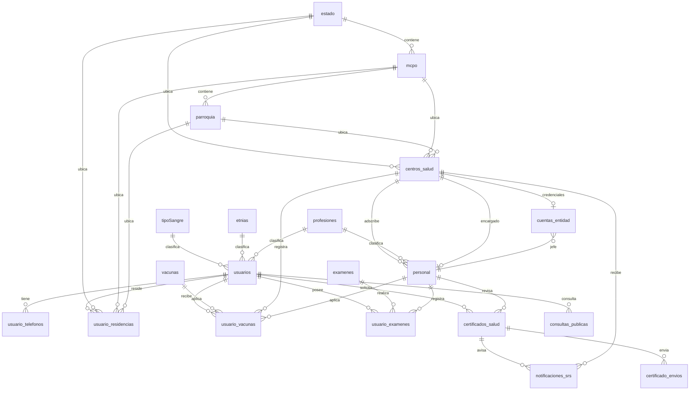
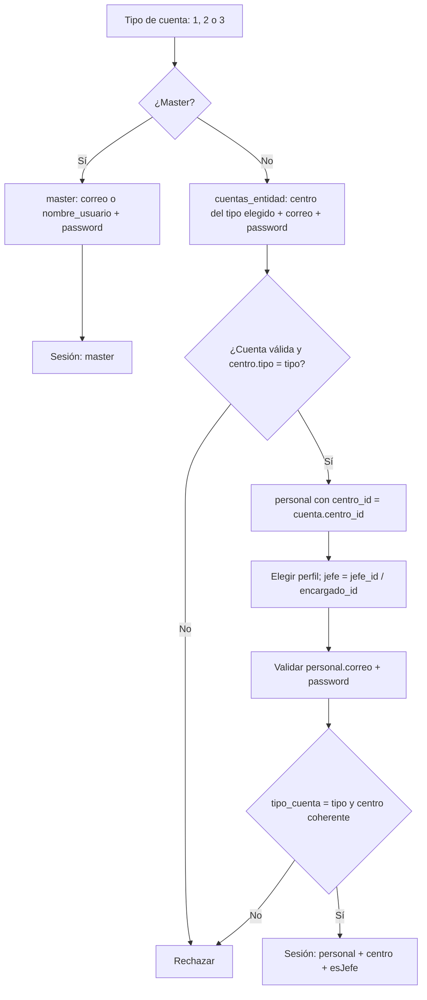

# Modelo de datos

Última actualización: 2026-10-29
Estado: **esquema de trabajo, todavía no implementado**.

> Fuente de verdad: [`docs/referencias/db_schema.sql`](../referencias/db_schema.sql). Ese archivo
> parte de las **16 tablas recibidas el 2026-10-25** y agrega, al final, las extensiones
> propuestas por el prototipo. La copia fiel del script recibido se conserva en
> [`db_schema_original_2026-10-25.sql`](../referencias/db_schema_original_2026-10-25.sql).
>
> No hay backend, migraciones, ORM, conexión a base de datos ni datos reales. Este documento
> describe el diseño objetivo y la correspondencia con los mocks; no se ejecuta nada todavía.
>
> Las tablas de lotes/stock, movimientos e incidencias siguen sin recibirse. No se inventan
> sus columnas definitivas.

## 1. Resumen

- Motor probable: MySQL o MariaDB (`AUTO_INCREMENT`, `JSON`, `TEXT`, `ENUM`).
- **16 tablas recibidas** de ciudadanía, personal, centros, geografía y catálogos clínicos.
- **5 tablas propuestas** para completar los flujos de esta etapa: `cuentas_entidad`,
  `certificados_salud`, `notificaciones_srs`, `certificado_envios` y `consultas_publicas`.
- **`usuarios` es la tabla de ciudadanos**, no la de cuentas. Las cuentas internas están en
  `personal` (roles 2 y 3), `master` (rol 1) y `cuentas_entidad`.
- **No existe una tabla `ciudadano`**: la ficha se arma con `usuarios` + `usuario_telefonos` +
  `usuario_residencias` + catálogos clínicos.
- **No existe una tabla `subregion`**: la sede de subregión es una fila de `centros_salud` con
  `tipo = 3`. Hay una por estado.
- `personal.tipo_cuenta` (2 o 3) debe coincidir con `centros_salud.tipo` y con el login elegido.
- La bandeja de la subregión solo recibe notificaciones de **solicitudes de certificado que ya
  cumplen todos los requisitos**. No hay avisos por vacunas o exámenes vencidos, ni por ESAVI,
  ni notificaciones de sistema.
- La consulta pública no pide sesión ni código de verificación en esta etapa. Los datos clínicos
  son de **solo lectura**; el envío del certificado al correo es una simulación.
- Siguen pendientes de recibir: lotes/stock, movimientos, búsquedas históricas del master e
  incidencias.

### Decisiones confirmadas el 2026-10-25

| Tema                    | Decisión                                                                                                                               |
| ----------------------- | -------------------------------------------------------------------------------------------------------------------------------------- |
| Alcance del script      | Es **parcial**. Faltan tablas que se agregarán después.                                                                                |
| Subregión               | Es una sede dentro de `centros_salud` con `tipo = 3`; una por estado.                                                                  |
| Tipo de centro          | `centros_salud.tipo` solo vale **2 (centro)** o **3 (sede de subregión)**. No se modela hospital/ambulatorio/CDI: el nombre lo indica. |
| Personal de subregión   | Es `personal` con `tipo_cuenta = 3` y `centro_id` apuntando a la sede de subregión.                                                    |
| Validación del login    | El tipo de cuenta elegido debe coincidir con `personal.tipo_cuenta`; el master se valida aparte.                                       |
| Login de entidad        | Dos niveles: `cuentas_entidad` (credenciales de la entidad) y el perfil de `personal` elegido.                                         |
| Jefe del centro         | Hay **un solo jefe por centro o sede**. Se deriva de `centros_salud.encargado_id`.                                                     |
| Sexo del ciudadano      | Se agrega a `usuarios` como `ENUM('F','M','otro')`.                                                                                    |
| Fecha de registro       | Se agrega `usuarios.creado_en` para el filtro del master.                                                                              |
| Profesión del ciudadano | Se pide en el alta. Si no tiene, se selecciona **"Desempleado"**; `profesion_id` sigue siendo obligatorio.                             |
| Saludo del master       | El dashboard saluda con `master.nombre_usuario`; no se agrega `master.nombre`.                                                         |

### Decisiones confirmadas el 2026-10-29

| Tema                           | Decisión                                                                                                                                            |
| ------------------------------ | --------------------------------------------------------------------------------------------------------------------------------------------------- |
| Notificaciones de la subregión | Solo se crean cuando una solicitud de certificado reúne todos los requisitos y queda lista para revisión.                                           |
| Avisos clínicos                | Los vencimientos de vacunas/exámenes y los ESAVI **no** generan notificaciones en esta etapa.                                                       |
| Correo del certificado         | La consulta pública permite simular el envío solo si el certificado está `autorizado` o `emitido`. No se implementa código de verificación todavía. |
| Consulta pública               | Busca por cédula en `usuarios`, muestra datos personales y el estado del certificado. El detalle clínico sensible no se expone.                     |
| Esquema                        | Las extensiones se agregan al final de `db_schema.sql`; el archivo original recibido se conserva intacto y fechado.                                 |

## 2. Diagrama del esquema y la propuesta

Solo se dibujan las relaciones declaradas por el SQL de trabajo. La relación
`centros_salud.encargado_id → personal.id` sigue siendo lógica: el script no la declara y crea una
dependencia circular (el centro necesita encargado y el personal necesita centro).



## 3. Tablas

### 3.1 Ciudadanía

#### `usuarios`

| Campo          | Tipo                 | Nulo | Relación / nota                                              |
| -------------- | -------------------- | ---- | ------------------------------------------------------------ |
| `id`           | INT UNSIGNED         | NO   | PK autoincremental                                           |
| `nombre1`      | VARCHAR(255)         | NO   | Primer nombre                                                |
| `nombre2`      | VARCHAR(255)         | NO   | Segundo nombre; la ficha lo trata como opcional              |
| `apellido1`    | VARCHAR(255)         | NO   | Primer apellido                                              |
| `apellido2`    | VARCHAR(255)         | NO   | Segundo apellido; la ficha lo trata como opcional            |
| `cedula`       | BIGINT               | NO   | Identificador público; **UNIQUE** en el esquema de trabajo   |
| `nacimiento`   | DATE                 | NO   | Habilita el filtro por rango de edad                         |
| `sangre_id`    | INT                  | NO   | FK `tipoSangre.id`                                           |
| `estatura`     | INT                  | NO   | Unidad por confirmar; asumir centímetros                     |
| `etnia_id`     | INT                  | SÍ   | FK `etnias.id`; nulo si no pertenece a un pueblo             |
| `correo`       | VARCHAR(255)         | NO   | Destino del certificado; **UNIQUE** en el esquema de trabajo |
| `profesion_id` | INT                  | NO   | FK `profesiones.id`                                          |
| `sexo`         | ENUM('F','M','otro') | NO   | Agregado; filtro de búsqueda y regla clínica                 |
| `creado_en`    | DATETIME             | NO   | Agregado; fecha de registro                                  |
| `activo`       | TINYINT(1)           | NO   | Agregado; baja lógica                                        |

- `nombre2`, `apellido2`, `estatura`, `sangre_id` y `profesion_id` son obligatorios en SQL. El
  alta pide todos; para quien no tenga profesión se usa la fila **"Desempleado"** del catálogo.
- `cedula` se normaliza a dígitos. No confundir con el formato visual `V-12345678`.
- El correo es obligatorio y único porque es el destino del certificado simulado.

#### `usuario_telefonos`

| Campo        | Tipo         | Nulo | Relación / nota                        |
| ------------ | ------------ | ---- | -------------------------------------- |
| `id`         | INT UNSIGNED | NO   | PK                                     |
| `telefono`   | VARCHAR(255) | NO   | Teléfono                               |
| `usuario_id` | INT          | SÍ   | FK `usuarios.id`; **debería ser `NO`** |

Un ciudadano puede tener varios teléfonos. La ficha muestra el primero como contacto principal y
reserva la lista completa para una vista de detalle. El índice por `usuario_id` ya está propuesto.

#### `usuario_residencias`

| Campo          | Tipo         | Nulo | Relación / nota             |
| -------------- | ------------ | ---- | --------------------------- |
| `id`           | INT UNSIGNED | NO   | PK                          |
| `estado_id`    | INT          | NO   | FK `estado.id`              |
| `mcpo_id`      | INT          | NO   | FK `mcpo.id` (municipio)    |
| `parroquia_id` | INT          | NO   | FK `parroquia.id`           |
| `direccion`    | VARCHAR(255) | NO   | Dirección exacta            |
| `usuario_id`   | INT          | NO   | FK `usuarios.id`            |
| `es_principal` | TINYINT(1)   | NO   | Agregado; residencia actual |

`es_principal` resuelve provisionalmente la duda de residencia actual. El esquema todavía no
impone una sola fila principal por usuario; esa regla queda para la aplicación o para una
restricción parcial cuando se elija el motor definitivo.

#### `usuario_vacunas`

| Campo              | Tipo         | Nulo | Relación / nota                                |
| ------------------ | ------------ | ---- | ---------------------------------------------- |
| `id`               | INT UNSIGNED | NO   | PK                                             |
| `usuario_id`       | INT          | NO   | FK `usuarios.id`                               |
| `vacuna_id`        | INT          | NO   | FK `vacunas.id`                                |
| `nro_dosis`        | INT          | SÍ   | Número de dosis                                |
| `fecha_aplicacion` | DATE         | NO   | Insumo del top 10 semanal                      |
| `lote`             | VARCHAR(255) | NO   | **Texto libre**, no es FK a una tabla de lotes |
| `centro_id`        | INT          | NO   | FK `centros_salud.id`                          |
| `personal_id`      | INT UNSIGNED | SÍ   | Agregado; quién aplicó o registró              |

El campo `lote` no permite reconstruir stock, estado ni destino de un cargamento. La vista
`/master/vacunas` sigue necesitando una tabla de lotes aparte.

#### `usuario_examenes`

| Campo                   | Tipo         | Nulo | Relación / nota                            |
| ----------------------- | ------------ | ---- | ------------------------------------------ |
| `id`                    | INT UNSIGNED | NO   | PK                                         |
| `usuario_id`            | INT          | NO   | FK `usuarios.id`                           |
| `examen_id`             | INT          | NO   | FK `examenes.id`                           |
| `fecha_realizacion`     | DATE         | NO   | Insumo de "vigente"                        |
| `resultado_cualitativo` | TEXT         | SÍ   | Texto libre                                |
| `resultado_json`        | JSON         | NO   | Resultado estructurado; contrato pendiente |
| `personal_id`           | INT UNSIGNED | SÍ   | Agregado; quién registró                   |
| `laboratorio`           | VARCHAR(255) | SÍ   | Agregado                                   |
| `adjunto_url`           | VARCHAR(512) | SÍ   | Agregado; referencia al documento          |

`resultado_json` es obligatorio, pero su contenido sigue sin contrato. La marca de examen
sensible vive en `examenes.sensible`, no en cada fila del ciudadano.

### 3.2 Catálogos clínicos

| Tabla         | Campos propuestos                                                                              | Observaciones                                        |
| ------------- | ---------------------------------------------------------------------------------------------- | ---------------------------------------------------- |
| `tipoSangre`  | `id`, `tipo`                                                                                   | Catálogo ABO/Rh; nombre en camelCase, a estandarizar |
| `etnias`      | `id`, `nombre`                                                                                 | Fuente definitiva pendiente                          |
| `vacunas`     | `id`, `nombre`, `descripcion`, `dosis_requeridas`, `vigencia_meses`, `obligatoria_certificado` | Reglas provisionales del certificado                 |
| `examenes`    | `id`, `nombre`, `categoria`, `vigencia_meses`, `sensible`, `obligatorio_certificado`           | Categoría y prueba en una sola tabla                 |
| `profesiones` | `id`, `nombre`                                                                                 | Debe incluir **"Desempleado"**                       |

- `vacunas.vigencia_meses` acepta `NULL` para una vacuna de vigencia permanente.
- `examenes.vigencia_meses` tiene valor por defecto 12; es una regla de prototipo que debe
  validar el equipo de salud.
- `obligatoria_certificado` y `obligatorio_certificado` permiten calcular los requisitos sin una
  tabla puente. La app mantiene además las listas de `nucleo/datos/subregion-salud.ts`.
- Los IDs reales son enteros; los mocks usan strings (`'td'`, `'a+'`). El mapeo futuro convierte
  ambos sentidos.

### 3.3 Geografía

| Tabla       | Campos                      | Observaciones                                 |
| ----------- | --------------------------- | --------------------------------------------- |
| `estado`    | `id`, `nombre`              | Nivel superior                                |
| `mcpo`      | `id`, `nombre`, `estado_id` | Municipio; `estado_id` obligatorio            |
| `parroquia` | `id`, `nombre`, `mcpo_id`   | `mcpo_id` **nullable**; conviene hacerlo `NO` |

La jerarquía `estado → municipio → parroquia` es única para todo el sistema. Debe venir de una
fuente oficial y cargarse una sola vez.

### 3.4 Centros, personal y cuentas

#### `centros_salud`

| Campo          | Tipo             | Nulo | Relación / nota                                     |
| -------------- | ---------------- | ---- | --------------------------------------------------- |
| `id`           | INT UNSIGNED     | NO   | PK                                                  |
| `estado_id`    | INT              | NO   | FK `estado.id`                                      |
| `mcpo_id`      | INT              | SÍ   | FK `mcpo.id`                                        |
| `parroquia_id` | INT              | SÍ   | FK `parroquia.id`                                   |
| `nombre`       | VARCHAR(255)     | NO   | Nombre del centro o de la sede de subregión         |
| `codigo`       | VARCHAR(255)     | NO   | Código visible; **UNIQUE** en el esquema de trabajo |
| `encargado_id` | INT              | NO   | **Sin FK declarada**; lógicamente `personal.id`     |
| `tipo`         | TINYINT UNSIGNED | NO   | Agregado; 2 = centro, 3 = sede de subregión         |
| `telefono`     | VARCHAR(255)     | SÍ   | Agregado                                            |
| `direccion`    | VARCHAR(255)     | SÍ   | Agregado                                            |
| `activo`       | TINYINT(1)       | NO   | Agregado; baja lógica                               |

- El tipo de establecimiento (hospital, ambulatorio, CDI…) se expresa en el nombre, no en una
  columna.
- Hay una subregión por estado. El esquema no impone todavía una restricción única
  `(estado_id, tipo = 3)`; se valida en la aplicación.
- `encargado_id` es el jefe del centro o de la sede. La FK no está declarada por la dependencia
  circular con `personal`.

#### `personal`

| Campo            | Tipo         | Nulo | Relación / nota                                   |
| ---------------- | ------------ | ---- | ------------------------------------------------- |
| `id`             | INT UNSIGNED | NO   | PK                                                |
| `tipo_cuenta`    | INT          | NO   | 2 = centro, 3 = subregión                         |
| `centro_id`      | INT          | NO   | FK `centros_salud.id`                             |
| `cedula`         | BIGINT       | NO   | **UNIQUE** en el esquema de trabajo               |
| `correo`         | VARCHAR(255) | NO   | Login; **UNIQUE** en el esquema de trabajo        |
| `nombre1`        | VARCHAR(255) | NO   |                                                   |
| `nombre2`        | VARCHAR(255) | NO   | La ficha lo trata como opcional                   |
| `apellido1`      | VARCHAR(255) | NO   |                                                   |
| `apellido2`      | VARCHAR(255) | NO   | La ficha lo trata como opcional                   |
| `nacimiento`     | DATE         | NO   |                                                   |
| `profesion_id`   | INT          | NO   | FK `profesiones.id`                               |
| `id_profesional` | VARCHAR(255) | NO   | Número profesional, no una FK                     |
| `password`       | VARCHAR(255) | NO   | **Texto plano en el script**; debe guardarse hash |
| `telefono`       | VARCHAR(255) | SÍ   | Agregado                                          |
| `direccion`      | VARCHAR(255) | SÍ   | Agregado                                          |
| `activo`         | TINYINT(1)   | NO   | Agregado; baja lógica                             |

- **Jefe/trabajador**: no hay campo `tipo_empleado`. Hay un solo jefe por centro, derivado de
  `centros_salud.encargado_id`: si `personal.id = centro.encargado_id`, es jefe.
- Siguen faltando grado de instrucción, servicio y años de servicio.
- No hay vínculo con `usuarios`: si un trabajador también es ciudadano, sus datos se duplican.
- `password` en claro es solo un borrador. Antes de implementar: hash, política de bloqueo y
  recuperación.

#### `master`

| Campo            | Tipo         | Nulo | Observación                      |
| ---------------- | ------------ | ---- | -------------------------------- |
| `id`             | INT UNSIGNED | NO   | PK                               |
| `nombre_usuario` | VARCHAR(255) | NO   | Login alternativo; **UNIQUE**    |
| `correo`         | VARCHAR(255) | NO   | Login; **UNIQUE**                |
| `password`       | VARCHAR(255) | NO   | Texto plano; debe guardarse hash |
| `activo`         | TINYINT(1)   | NO   | Agregado; baja lógica            |
| `creado_en`      | DATETIME     | NO   | Agregado                         |

No tiene nombre visible ni cédula. El dashboard saluda con `nombre_usuario`; no se agrega
`master.nombre`.

#### `cuentas_entidad` (propuesta)

| Campo       | Tipo         | Nulo | Relación / nota                                    |
| ----------- | ------------ | ---- | -------------------------------------------------- |
| `id`        | INT UNSIGNED | NO   | PK                                                 |
| `centro_id` | INT UNSIGNED | NO   | FK `centros_salud.id`; **UNIQUE**: una por entidad |
| `correo`    | VARCHAR(255) | NO   | Login de la entidad; **UNIQUE**                    |
| `password`  | VARCHAR(255) | NO   | Hash, nunca texto plano                            |
| `jefe_id`   | INT UNSIGNED | NO   | FK `personal.id`; distingue al jefe de los demás   |
| `activo`    | TINYINT(1)   | NO   | Baja lógica                                        |
| `creado_en` | DATETIME     | NO   | Fecha de creación                                  |

Resuelve el primer nivel del login de los roles 2 y 3 sin convertir al centro en una cuenta de
persona:

- Una fila por centro o sede de subregión. El rol no se guarda: se deriva de
  `centros_salud.tipo` (2 o 3) y debe coincidir con `personal.tipo_cuenta`.
- **No duplica la lista de perfiles**: los trabajadores son las filas de `personal` con el mismo
  `centro_id`.
- `jefe_id` debe coincidir con `centros_salud.encargado_id`; la aplicación o un trigger valida
  la coincidencia.
- El segundo nivel valida el correo y la contraseña de la fila de `personal` elegida. El jefe se
  marca comparando con `jefe_id` o `encargado_id`.
- Siguen pendientes recuperación, último acceso y bloqueo por intentos.

### 3.5 Certificados, notificaciones y consulta pública

#### `certificados_salud`

| Campo                        | Tipo                                                   | Nulo | Relación / nota                              |
| ---------------------------- | ------------------------------------------------------ | ---- | -------------------------------------------- |
| `id`                         | INT UNSIGNED                                           | NO   | PK                                           |
| `codigo`                     | VARCHAR(64)                                            | NO   | **UNIQUE**; código visible del certificado   |
| `usuario_id`                 | INT UNSIGNED                                           | NO   | FK `usuarios.id`                             |
| `estado`                     | ENUM('solicitado','autorizado','descartado','emitido') | NO   | Estado del trámite                           |
| `canal_solicitud`            | ENUM('subregion','consulta_publica')                   | NO   | Origen de la solicitud                       |
| `solicitado_por_personal_id` | INT UNSIGNED                                           | SÍ   | FK `personal.id`; ventanilla de la subregión |
| `revisado_por_personal_id`   | INT UNSIGNED                                           | SÍ   | FK `personal.id`; autorizador                |
| `fecha_solicitud`            | DATETIME                                               | NO   | Fecha de recepción                           |
| `fecha_revision`             | DATETIME                                               | SÍ   | Fecha de decisión                            |
| `fecha_emision`              | DATETIME                                               | SÍ   | Fecha de emisión                             |
| `motivo`                     | TEXT                                                   | SÍ   | Motivo de descarte                           |
| `observaciones`              | TEXT                                                   | SÍ   | Notas internas                               |
| `creado_en`                  | DATETIME                                               | NO   | Auditoría mínima                             |
| `actualizado_en`             | DATETIME                                               | NO   | Auditoría mínima                             |

Reglas de transición del prototipo:

```text
solicitado → autorizado → emitido
solicitado → descartado
```

- Una solicitud activa por ciudadano: `solicitado` o `autorizado`. `emitido` y `descartado`
  liberan al ciudadano para una nueva solicitud. El esquema no puede imponer una restricción
  parcial de forma portable; la regla vive en el servicio.
- `motivo` es obligatorio cuando el estado pasa a `descartado`.
- El certificado no guarda un snapshot de los requisitos. La evaluación se calcula desde las
  vacunas y exámenes vigentes. Antes de emitir documentos legales hay que decidir si se
  congelan los datos evaluados.
- No hay firma electrónica, PDF ni validez legal. La vista de certificado es una simulación.

#### `notificaciones_srs`

| Campo                 | Tipo                          | Nulo | Relación / nota                                 |
| --------------------- | ----------------------------- | ---- | ----------------------------------------------- |
| `id`                  | INT UNSIGNED                  | NO   | PK                                              |
| `centro_subregion_id` | INT UNSIGNED                  | NO   | FK `centros_salud.id`; sede que recibe el aviso |
| `certificado_id`      | INT UNSIGNED                  | NO   | FK `certificados_salud.id`                      |
| `usuario_id`          | INT UNSIGNED                  | NO   | FK `usuarios.id`; ciudadano solicitante         |
| `tipo`                | ENUM('solicitud_certificado') | NO   | Único tipo permitido                            |
| `titulo`              | VARCHAR(255)                  | NO   | Texto visible                                   |
| `mensaje`             | TEXT                          | NO   | Texto visible                                   |
| `prioridad`           | ENUM('alta','media','baja')   | NO   | Orden de la bandeja                             |
| `leida`               | TINYINT(1)                    | NO   | Estado de lectura                               |
| `creada_en`           | DATETIME                      | NO   | Fecha de creación                               |
| `leida_en`            | DATETIME                      | SÍ   | Fecha de lectura                                |

- La clave única `(certificado_id, tipo)` evita duplicar el aviso de una misma solicitud.
- Solo se inserta una fila cuando la solicitud **cumple todos los requisitos**. Si la solicitud
  se crea incompleta, no se notifica.
- Revisar, autorizar, descartar o emitir **no crean notificaciones adicionales**. La bandeja es
  una cola de trabajo, no un historial de cambios.
- No hay notificaciones de vacunas/exámenes vencidos ni de ESAVI.
- El estado de la subregión se deriva del `centro_subregion_id`; la app puede filtrar por
  `estado_id` sin duplicar esa columna en cada notificación.

#### `certificado_envios`

| Campo            | Tipo                                 | Nulo | Relación / nota                        |
| ---------------- | ------------------------------------ | ---- | -------------------------------------- |
| `id`             | INT UNSIGNED                         | NO   | PK                                     |
| `certificado_id` | INT UNSIGNED                         | NO   | FK `certificados_salud.id`             |
| `correo_destino` | VARCHAR(255)                         | NO   | Correo registrado al momento del envío |
| `estado`         | ENUM('simulado','enviado','fallido') | NO   | `simulado` en esta etapa               |
| `enviado_en`     | DATETIME                             | NO   | Fecha del intento                      |
| `error`          | TEXT                                 | SÍ   | Detalle si falla                       |

- El botón público solo aparece para certificados `autorizado` o `emitido`.
- No se guarda ni se valida código de verificación: esa función está fuera del alcance actual.
- La app actual usa el booleano de vista `correoEnviado`; el esquema normaliza el envío como
  fila de `certificado_envios`. Un certificado puede tener más de un intento; la política de
  reenvío queda abierta.
- En esta etapa no se envía un correo real. La fila documenta la simulación.

#### `consultas_publicas`

| Campo               | Tipo         | Nulo | Relación / nota                          |
| ------------------- | ------------ | ---- | ---------------------------------------- |
| `id`                | INT UNSIGNED | NO   | PK                                       |
| `usuario_id`        | INT UNSIGNED | SÍ   | FK `usuarios.id`; nulo si no se encontró |
| `cedula_consultada` | BIGINT       | NO   | Cédula normalizada                       |
| `encontrada`        | TINYINT(1)   | NO   | Resultado de la búsqueda                 |
| `origen`            | VARCHAR(64)  | NO   | `consulta_publica` por defecto           |
| `creado_en`         | DATETIME     | NO   | Fecha de la consulta                     |

- La app todavía no escribe esta auditoría; queda propuesta para cuando exista backend.
- No guarda el detalle clínico devuelto, solo el hecho de la consulta y si hubo coincidencia.
- La consulta pública no requiere sesión ni código en esta etapa.

### 3.6 Tablas que siguen faltando

| Tabla / dominio      | Para qué se necesita                                      | Estado      |
| -------------------- | --------------------------------------------------------- | ----------- |
| Lotes / stock        | Dashboard del master, recepción y distribución de vacunas | No recibida |
| Movimientos          | Auditoría de stock y trazabilidad                         | No recibida |
| Búsquedas del master | Historial de búsquedas y filtros usados                   | No recibida |
| Incidencias / ESAVI  | Reacciones adversas y problemas de lote                   | No recibida |

No se inventan columnas definitivas para estas tablas. Las vistas usan mocks y lo indican.

## 4. Correspondencia con el código y las vistas

| Concepto actual en la app          | Tabla(s) / campos reales                                                                           | Estado                                      |
| ---------------------------------- | -------------------------------------------------------------------------------------------------- | ------------------------------------------- |
| `Ciudadano`                        | `usuarios` + `usuario_telefonos` + `usuario_residencias` + `tipoSangre` + `etnias` + `profesiones` | Acordado: `sexo`, `creado_en`, `activo`     |
| `FichaCiudadano`                   | Lo anterior + `usuario_vacunas` + `usuario_examenes` + reglas de `vacunas`/`examenes`              | Parcial: requiere contrato de vigencia      |
| `Personal`                         | `personal` + `centros_salud` + `profesiones`                                                       | Parcial: contactos y baja lógica agregados  |
| `Master`                           | `master`                                                                                           | Resuelto: saluda con `nombre_usuario`       |
| `CentroSalud`                      | `centros_salud` + geografía + `personal` del encargado                                             | Resuelto: `tipo` 2/3                        |
| `Subregión`                        | `centros_salud` con `tipo = 3` + `estado` + `personal` del encargado                               | Resuelto                                    |
| Cuenta de entidad (roles 2 y 3)    | `cuentas_entidad` + `centros_salud` + `personal`                                                   | Propuesta                                   |
| Rol 2 / Rol 3                      | `personal.tipo_cuenta` + `centros_salud.tipo` + `cuentas_entidad`                                  | Confirmado; falta implementar               |
| Perfil jefe / trabajador           | Derivado de `centros_salud.encargado_id`; un solo jefe por centro                                  | Confirmado                                  |
| `Catálogos`                        | `tipoSangre`, `etnias`, `vacunas`, `examenes`, `profesiones`                                       | Disponibles; IDs enteros                    |
| `VacunaCatalogo`                   | `vacunas`                                                                                          | Resuelto: dosis, vigencia y obligatoriedad  |
| `SolicitudCertificado`             | `certificados_salud`                                                                               | Propuesta                                   |
| `NotificacionSrs`                  | `notificaciones_srs`                                                                               | Propuesta; solo solicitudes completas       |
| `correoEnviado`                    | `certificado_envios`                                                                               | Propuesta; envío simulado                   |
| Consulta pública                   | `usuarios` + `certificados_salud` + `certificado_envios`; auditoría en `consultas_publicas`        | Implementada con mocks; auditoría pendiente |
| `Lote`                             | No hay tabla; `usuario_vacunas.lote` es solo un texto                                              | Bloqueado                                   |
| `Movimiento` / `Busqueda`          | No hay tablas                                                                                      | Bloqueado                                   |
| `Incidencia`                       | No hay tabla                                                                                       | Bloqueado                                   |
| `EstadoLote` / `EstadoCertificado` | `EstadoCertificado` ya se refleja en `certificados_salud.estado`; `EstadoLote` no tiene tabla      | Parcial                                     |

## 5. Flujos de datos

### 5.1 Login



- **Master**: se busca en `master` por correo (o `nombre_usuario`) y contraseña. No puede entrar
  por el login de centro/subregión.
- **Primer nivel (roles 2 y 3)**: se busca la fila de `cuentas_entidad` por correo y contraseña, y
  se comprueba que `centro_id` apunte a un `centros_salud.tipo` coherente: centro normal para 2,
  sede de subregión para 3.
- **Segundo nivel**: se listan las filas de `personal` con ese `centro_id`. El jefe coincide con
  `cuentas_entidad.jefe_id` (y con `centros_salud.encargado_id`); el resto son trabajadores. Se
  validan el correo y la contraseña de la fila elegida.
- **Seguridad pendiente**: hash, bloqueo por intentos, recuperación y registro de último acceso.

### 5.2 Consulta pública

La vista `/consulta` está implementada con mocks, no modifica datos clínicos y solo simula el envío del certificado.

1. El ciudadano escribe la cédula. Se normaliza a dígitos y se busca en `usuarios.cedula`
   (`UNIQUE` en el esquema de trabajo).
2. **Esta etapa no pide código de verificación.** La búsqueda devuelve la ficha directamente,
   tal como se acordó para el prototipo.
3. La ficha pública se arma con:
   - `usuarios` + `tipoSangre` + `etnias` + `profesiones`;
   - `usuario_telefonos`;
   - `usuario_residencias` + `estado` + `mcpo` + `parroquia`;
   - conteos de `usuario_vacunas` y `usuario_examenes`.
4. La vista no muestra lote, centro de vacunación ni detalle de exámenes sensibles. Solo muestra
   conteos y el estado del certificado.
5. Para el certificado se busca la última solicitud `autorizado` o `emitido`; si no existe, se
   muestra la solicitud más reciente. Si no hay ninguna, se muestra un estado vacío.
6. Si el certificado está aprobado o emitido, el ciudadano puede pulsar **Enviar certificado a mi
   correo**. La acción marca el envío simulado en el mock y no envía un correo real; con backend
   corresponderá a una fila de `certificado_envios`.
7. La auditoría en `consultas_publicas` queda propuesta; la app todavía no la escribe.
8. La vigencia de vacunas y exámenes es una regla provisional del prototipo y debe validarla el
   equipo de salud.

### 5.3 Alta de ciudadano

- Insertar primero `usuarios`; después `usuario_telefonos` y `usuario_residencias`.
- Campos obligatorios del SQL: nombres y apellidos (incluidos `nombre2` y `apellido2`), cédula,
  nacimiento, sangre, estatura, correo y profesión.
- El alta pide la profesión. Si el ciudadano no tiene, se selecciona **"Desempleado"**, que debe
  existir en el catálogo `profesiones`; `profesion_id` sigue siendo obligatorio.
- La estatura está dibujada sin unidad: confirmar que se guarda en centímetros.
- `creado_en` se llena automáticamente; no se pide en el formulario.
- `etnia_id` es opcional.
- El correo es obligatorio y único porque es el destino del certificado simulado.

### 5.4 Registro de vacunación

- Insertar en `usuario_vacunas`: ciudadano, vacuna, número de dosis, fecha, lote (texto), centro
  y `personal_id`.
- No hay stock ni tabla de lotes: el control de cargamentos del master no se puede construir con
  este script.
- Se pueden calcular métricas por centro y por estado usando `usuario_vacunas.centro_id` →
  `centros_salud.estado_id` y `fecha_aplicacion`.
- La obligatoriedad y la vigencia para el certificado salen de `vacunas`.

### 5.5 Registro de exámenes

- Insertar en `usuario_examenes`: ciudadano, examen, fecha, resultado cualitativo, JSON,
  `personal_id`, laboratorio y adjunto.
- `examenes.categoria` + `examenes.nombre` sustituye la jerarquía de dos tablas propuesta.
- Definir el contrato de `resultado_json` antes de crear modelos TypeScript.
- La marca `examenes.sensible` evita exponer VIH/VDRL en la consulta pública; la vista solo
  muestra conteos.

### 5.6 Dashboard del master

| Card                                            | ¿Se puede con el esquema actual? | Cómo                                                                                                                                |
| ----------------------------------------------- | -------------------------------- | ----------------------------------------------------------------------------------------------------------------------------------- |
| 1. Últimos lotes                                | **No**                           | No hay tabla de lotes. `usuario_vacunas.lote` es un texto de dosis aplicadas, no stock.                                             |
| 2. Top 10 estados por vacunaciones de la semana | **Sí**                           | Contar `usuario_vacunas` uniendo `centro_id` → `centros_salud.estado_id`, filtrando por `fecha_aplicacion` de la semana calendario. |
| 3. Mapa estado → municipio → parroquia          | **Sí, con geodatos**             | Las tablas `estado`, `mcpo` y `parroquia` existen; falta cargar la fuente oficial y decidir el mapa.                                |

- El saludo "Bienvenido, {nombre}" se resuelve con `master.nombre_usuario`.
- "Usuarios activos" ya puede usar `usuarios.activo`, pero falta definir la ventana de actividad.
- "Movimientos" y "búsquedas" siguen bloqueados hasta recibir sus tablas.

### 5.7 Búsqueda global del master

| Filtro dibujado     | Fuente real                                             | Estado                          |
| ------------------- | ------------------------------------------------------- | ------------------------------- |
| Nombres / apellidos | `usuarios.nombre1`, `nombre2`, `apellido1`, `apellido2` | Disponible                      |
| Cédula              | `usuarios.cedula`                                       | Disponible; normalizar          |
| Vacunas             | `usuario_vacunas` + `vacunas`                           | Disponible                      |
| Rango de edad       | `usuarios.nacimiento`                                   | Disponible                      |
| Exámenes            | `usuario_examenes` + `examenes`                         | Disponible                      |
| Fecha de registro   | `usuarios.creado_en`                                    | Disponible                      |
| Sexo                | `usuarios.sexo`                                         | Disponible                      |
| Etnia               | `usuarios.etnia_id` + `etnias`                          | Disponible                      |
| Ubicación           | `usuario_residencias` + geografía                       | Disponible; usar `es_principal` |

La regla de "al menos 2 filtros" es de interfaz y no cambia. La búsqueda es sobre ciudadanos, no
sobre personal ni centros.

### 5.8 Administración de personal del master

- **Subregiones**: filas de `centros_salud` con `tipo = 3`, unidas a `estado` y a `personal` por
  `encargado_id`. Columnas: nombre de la sede, estado y nombre del administrador.
- **Centros**: filas de `centros_salud` con `tipo = 2`, unidas a geografía y al encargado.
- **Empleados**: `personal` unido a `centros_salud`; la ubicación se deriva del centro. El filtro
  jefe/trabajador se deriva de `encargado_id`; hay un solo jefe por centro. El tipo de
  establecimiento se expresa en el nombre.
- **Formularios de alta**: no dibujados; dependen de cerrar los campos obligatorios y las reglas
  de contraseña.

### 5.9 Personal de salud y subregión

- **Rol 2 (centro)**: el centro de la sesión es `personal.centro_id`. Las filas de `personal` con
  ese `centro_id` son el equipo; el jefe es `encargado_id`. Las métricas de vacunación se filtran
  por `usuario_vacunas.centro_id`.
- **Rol 3 (subregión)**: la sede es el `centros_salud` tipo 3 de la sesión; su estado es
  `estado_id`. Los centros del estado son las filas tipo 2 con ese `estado_id`; el personal se
  obtiene por `centro_id`.
- Los certificados y las notificaciones ya tienen tablas propuestas; el stock sigue bloqueado.
- La bandeja de notificaciones **no** incluye vencimientos: solo solicitudes completas listas
  para revisión.

### 5.10 Certificados, notificaciones y envío

1. La subregión crea una solicitud en `certificados_salud` (`estado = solicitado`).
2. La evaluación de requisitos usa `vacunas`/`examenes` y los datos del ciudadano. Si el
   expediente está completo, se inserta **una** fila en `notificaciones_srs` para la sede de la
   subregión. Si está incompleto, no se notifica.
3. La subregión revisa la solicitud. Autorizar o descartar cambia el estado y `fecha_revision`;
   **no crea otra notificación**.
4. Un certificado autorizado se emite (`estado = emitido`, `fecha_emision`). La emisión tampoco
   crea notificaciones.
5. En la consulta pública, el ciudadano ve el estado y, si está aprobado o emitido, puede pedir el
   envío. La app marca `correoEnviado` en el mock; con backend, el intento se registrará en
   `certificado_envios`.
6. No hay correo real, enlace firmado, PDF legal ni código de verificación. La UI lo advierte.
7. Incidencias/ESAVI y movimientos siguen fuera del alcance hasta recibir sus tablas.

## 6. Qué se puede construir ya

| Vista                    | Datos disponibles                                                         | Bloqueo principal                     |
| ------------------------ | ------------------------------------------------------------------------- | ------------------------------------- |
| Landing `/`              | No depende de BD                                                          | —                                     |
| Login `/login`           | `master`, `personal` y `cuentas_entidad`; tipo de cuenta y centro         | Implementado con mocks; falta backend |
| Consulta `/consulta`     | `usuarios`, residencia, contacto, conteos clínicos y `certificados_salud` | Implementada con mocks                |
| Ficha del ciudadano      | Datos personales, residencia, teléfonos, vacunas y exámenes               | Contrato de `resultado_json`          |
| Dashboard master, card 2 | Vacunaciones por estado/semana                                            | —                                     |
| Dashboard master, card 1 | —                                                                         | Tabla de lotes                        |
| Dashboard master, card 3 | Geografía                                                                 | Geodatos oficiales                    |
| Búsqueda global          | Casi todos los filtros                                                    | —                                     |
| Control de vacunas       | Dosis aplicadas                                                           | Tabla de lotes/stock                  |
| Admin. subregiones       | `centros_salud.tipo = 3` + encargado                                      | —                                     |
| Admin. centros           | `centros_salud.tipo = 2` + encargado                                      | —                                     |
| Admin. empleados         | `personal` + centro + encargado                                           | Grado de instrucción y servicio       |
| Movimientos / búsquedas  | —                                                                         | Tablas de auditoría                   |
| Dashboard PS             | Personal del centro y vacunaciones                                        | Exámenes sin centro                   |
| Dashboard SRS            | Centros, vacunaciones, certificados y notificaciones del estado           | Stock                                 |
| Certificados             | `certificados_salud` + `notificaciones_srs` + `certificado_envios`        | Implementado con mocks                |

## 7. Cambios y huecos del esquema

### 7.1 Aplicados en el esquema de trabajo

- `usuarios`: `sexo`, `creado_en`, `activo`, `UNIQUE` en `cedula` y `correo`.
- `usuario_residencias`: `es_principal`.
- `usuario_vacunas`: `personal_id`.
- `usuario_examenes`: `personal_id`, `laboratorio`, `adjunto_url`.
- `vacunas`: `dosis_requeridas`, `vigencia_meses`, `obligatoria_certificado`.
- `examenes`: `vigencia_meses`, `sensible`, `obligatorio_certificado`.
- `centros_salud`: `tipo`, `telefono`, `direccion`, `activo`, `UNIQUE` en `codigo`.
- `personal`: `telefono`, `direccion`, `activo`, `UNIQUE` en `cedula` y `correo`.
- `master`: `activo`, `creado_en`, `UNIQUE` en `nombre_usuario` y `correo`.
- `cuentas_entidad`: tabla propuesta con `centro_id`, `correo`, `password`, `jefe_id`, `activo` y
  `creado_en`.
- `certificados_salud`, `notificaciones_srs`, `certificado_envios` y `consultas_publicas`: tablas
  propuestas.
- Índices por cédula, correo, estado de certificado, bandeja de notificaciones, envíos, personal
  y centro.

### 7.2 Pendientes de recibir o confirmar

**Tablas**

- Lotes/stock, movimientos, búsquedas históricas e incidencias/ESAVI.
- Snapshot de requisitos del certificado si se decide congelar la evaluación.
- Firma, PDF y verificación pública del certificado si se vuelve legal.

**Columnas y restricciones**

- `centros_salud.encargado_id`: FK diferida o estrategia para la dependencia circular.
- Una sola sede tipo 3 por estado; una sola residencia principal por usuario.
- Una sola solicitud activa por ciudadano a nivel de base de datos (hoy se valida en el servicio).
- `usuario_telefonos.usuario_id` debería ser `NOT NULL`.
- `personal`: grado de instrucción, servicio y años de servicio.
- `cuentas_entidad`: recuperación, último acceso y bloqueo por intentos.
- `examenes`: categoría acotada a catálogo o `ENUM`, y contrato de `resultado_json`.
- `consultas_publicas`: política de retención y acceso a la auditoría.

**Seguridad y operación**

- Hash de contraseñas en `master`, `personal` y `cuentas_entidad`.
- `activo`, bloqueo por intentos, recuperación y último acceso.
- Correo real, código de verificación y plantilla del certificado.
- Auditoría: decidir si se escribe desde la aplicación o con triggers.
- Zona horaria y formato de fechas.

**Nomenclatura**

- `tipoSangre` (camelCase) frente al resto en snake_case.
- `mcpo` como abreviatura de municipio.
- `tipo_cuenta` (SQL) frente a `tipo_usuario` (conversación): elegir uno.
- Singular/plural inconsistente (`estado`, `mcpo`, `parroquia`, `vacunas`, `examenes`).

## 8. Preguntas abiertas

Ya respondidas:

1. El script es parcial.
2. La subregión es una sede de `centros_salud` con `tipo`, no una tabla aparte.
3. Se agrega `sexo` a `usuarios` como `ENUM('F','M','otro')`.
4. El login valida `personal.tipo_cuenta` contra el tipo elegido.
5. `centros_salud.tipo` solo vale 2 (centro) o 3 (sede).
6. El login conserva dos niveles y agrega `cuentas_entidad`.
7. Hay un solo jefe por centro; se deriva de `encargado_id`.
8. El alta pide profesión; si no hay, se usa "Desempleado".
9. El master saluda con `nombre_usuario`.
10. Se agrega `usuarios.creado_en`.
11. Solo se notifican solicitudes de certificado completas.
12. El envío del certificado se simula en la consulta pública y no pide código todavía.
13. La consulta pública muestra datos personales y el estado del certificado, sin detalle clínico
    sensible.

Siguen abiertas, por orden de impacto:

1. **`tipo_cuenta`**: ¿se renombra a `tipo_usuario` para alinear SQL y conversación?
2. **Residencia principal**: ¿basta `es_principal` o se necesita historial completo?
3. **Resultado de examen**: ¿qué estructura tendrá `resultado_json`? ¿Cómo se marca y filtra un
   examen sensible además de `examenes.sensible`?
4. **Vigencia**: ¿se guarda calculada o se deriva de las reglas por vacuna/examen? ¿Quién valida
   los períodos reales?
5. **Snapshot**: ¿el certificado congela los requisitos evaluados o los recalcula al mostrarse?
6. **Reenvíos**: ¿se permite pedir el certificado varias veces? ¿Cuántos intentos se auditan?
7. **Correo real y verificación**: ¿qué proveedor y qué flujo de código se usarán?
8. **Auditoría pública**: ¿se registra cada consulta por cédula? ¿Cuánto tiempo se conserva?
9. **Tablas faltantes**: ¿cuándo llegan lotes, movimientos, búsquedas e incidencias?
10. **Geografía**: ¿de qué fuente oficial se cargan estados, municipios y parroquias?
11. **Personal y ciudadano**: ¿son entidades separadas aunque la misma persona aparezca en ambas?
12. **Nombre de la tabla de entidad**: ¿`cuentas_entidad` es el nombre definitivo?

## 9. Reglas para la implementación futura

- No importar el SQL ni las tablas desde componentes. El mapeo vive en
  `src/app/nucleo/servicios/`.
- Los servicios exponen modelos de **vista** (lo que la pantalla pinta), no filas crudas.
- Los IDs reales son enteros; los mocks usan strings. Convertir en el mapeo, no en las plantillas.
- Mantener los mocks hasta que exista backend. No crear migraciones, ORM ni conexiones todavía.
- Filtrar datos sensibles en la capa de servicio y en la vista pública, no solo en la UI.
- Guardar contraseñas con hash y no reutilizar las credenciales de `credenciales-demo.md`.
- `cuentas_entidad` no reemplaza al perfil: abre el primer nivel; la sesión y los permisos salen
  de `personal`.
- No duplicar la lista de perfiles: se obtienen por `personal.centro_id`.
- La bandeja de la subregión solo recibe una notificación por solicitud completa. Revisar o
  emitir no genera avisos nuevos.
- El envío del certificado es idempotente en el prototipo: no se repite si `correoEnviado` ya es
  verdadero. La política real de reenvíos queda abierta.
- `docs/referencias/db_schema.sql` es el esquema de trabajo. La copia original fechada no se
  modifica. Cualquier cambio nuevo se documenta aquí y se agrega como extensión revisada, no como
  migración ejecutada.
- No inventar columnas para lotes, movimientos o incidencias hasta recibir esa parte.

## 10. Referencias

- [`docs/referencias/db_schema.sql`](../referencias/db_schema.sql): esquema de trabajo con las
  extensiones del prototipo.
- [`docs/referencias/db_schema_original_2026-10-25.sql`](../referencias/db_schema_original_2026-10-25.sql):
  copia fiel del script recibido.
- [`docs/referencias/README.md`](../referencias/README.md): procedencia, integridad y reglas de la
  carpeta.
- [`docs/diseno/modelo-datos-preliminar.md`](./modelo-datos-preliminar.md): boceto histórico.
- [`docs/diseno/vistas.md`](./vistas.md): navegación y comportamiento de las pantallas.
- [`docs/arquitectura.md`](../arquitectura.md): decisiones generales y estado del proyecto.
