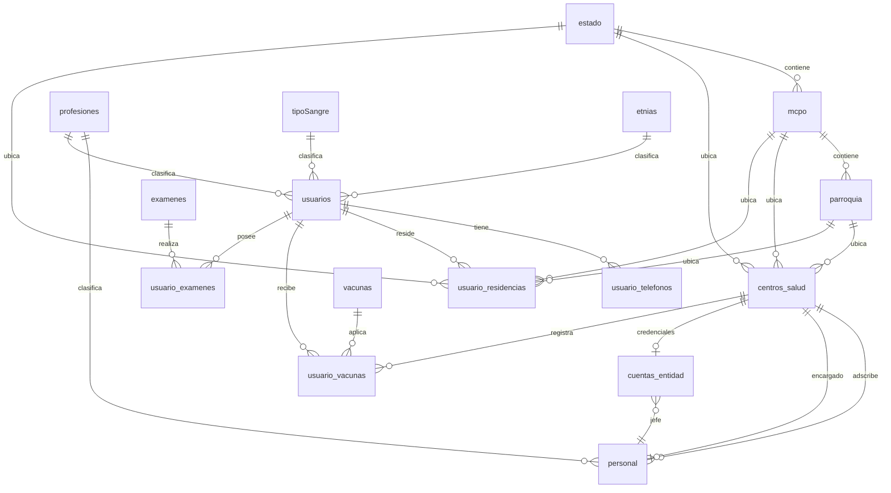
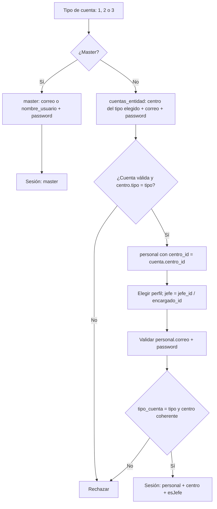

# Modelo de datos

Última actualización: 2026-10-25
Estado: **esquema real parcial**. Documento de diseño; **no implementado**.

> Fuente única: [`docs/referencias/db_schema.sql`](../referencias/db_schema.sql), recibido el
> 2026-10-25. Si este documento y el SQL difieren, manda el SQL.
>
> El script es **parcial**: faltan tablas que las vistas ya necesitan. Las ausencias se
> registran como pendientes de recibir, no como decisiones de producto.
>
> No hay backend, migraciones, ORM ni conexión a base de datos. Este documento sirve para
> alinear el diseño de vistas y preparar la futura capa de servicios; no se implementa nada
> todavía.

## 1. Resumen

- Motor probable: MySQL o MariaDB (`AUTO_INCREMENT`, `JSON`, `TEXT`).
- **16 tablas recibidas** de ciudadanía, personal, centros, geografía y catálogos clínicos,
  más **1 tabla propuesta** (`cuentas_entidad`) para el login de entidad. La propuesta no está
  en el script recibido.
- **`usuarios` es la tabla de ciudadanos**, no la de cuentas. Las cuentas internas están en
  `personal` (roles 2 y 3), `master` (rol 1) y la cuenta de entidad propuesta.
- **No existe una tabla `ciudadano`**: el ciudadano se arma con `usuarios` +
  `usuario_telefonos` + `usuario_residencias` + catálogos.
- **No existe una tabla `subregion`**: la sede de subregión será una fila de
  `centros_salud` con un campo `tipo` que hay que agregar. Habrá una por estado.
- `personal.centro_id` apunta siempre a un centro o a una sede de subregión. El campo
  `personal.tipo_cuenta` (2 o 3) debe coincidir con el tipo de centro y con el login elegido.
- **Pendiente de recibir**: lotes/stock, certificados, movimientos, búsquedas e incidencias.
- No hay marcas de tiempo, `activo`, índices explícitos ni restricciones `UNIQUE` en el script. Son
  requisitos de implementación, no campos que ya existan, salvo las columnas acordadas en la
  tabla siguiente.

### Decisiones confirmadas el 2026-10-25

| Tema                    | Decisión                                                                                                                               |
| ----------------------- | -------------------------------------------------------------------------------------------------------------------------------------- |
| Alcance del script      | Es **parcial**. Faltan tablas que se agregarán después.                                                                                |
| Subregión               | Es una sede dentro de `centros_salud` con un campo `tipo` (a agregar); una por estado.                                                 |
| Tipo de centro          | `centros_salud.tipo` solo vale **2 (centro)** o **3 (sede de subregión)**. No se modela hospital/ambulatorio/CDI: el nombre lo indica. |
| Personal de subregión   | Es `personal` con `tipo_cuenta = 3` y `centro_id` apuntando a la sede de subregión.                                                    |
| Validación del login    | El tipo de cuenta elegido debe coincidir con `personal.tipo_cuenta`; el master se valida aparte.                                       |
| Login de entidad        | Se conserva el flujo de dos niveles con una tabla propuesta `cuentas_entidad`: credenciales de la entidad, `centro_id` y `jefe_id`.    |
| Jefe del centro         | Hay **un solo jefe por centro o sede**. Se deriva de `centros_salud.encargado_id`; no hay `tipo_empleado`.                             |
| Sexo del ciudadano      | Se agregará a `usuarios`.                                                                                                              |
| Fecha de registro       | Se agregará `usuarios.creado_en` para el filtro del master.                                                                            |
| Profesión del ciudadano | Se pide en el alta. Si no tiene, se selecciona la profesión **"Desempleado"**; `profesion_id` sigue siendo obligatorio.                |
| Saludo del master       | El dashboard saluda con `master.nombre_usuario`; no se agrega `master.nombre`.                                                         |

## 2. Diagrama del esquema y la propuesta

Solo se dibujan las claves foráneas declaradas, salvo `cuentas_entidad`, que es una **propuesta**
para resolver el login y todavía no está en el script. La relación `centros_salud.encargado_id →
personal.id` también es lógica: **el script no la declara** y además crea una dependencia circular
(centro necesita encargado, personal necesita centro).

## 3. Tablas

### 3.1 Ciudadanía

#### `usuarios`

| Campo          | Tipo         | Nulo | Relación / nota                                       |
| -------------- | ------------ | ---- | ----------------------------------------------------- |
| `id`           | INT UNSIGNED | NO   | PK autoincremental                                    |
| `nombre1`      | VARCHAR(255) | NO   | Primer nombre                                         |
| `nombre2`      | VARCHAR(255) | NO   | Segundo nombre; la ficha lo trata como opcional       |
| `apellido1`    | VARCHAR(255) | NO   | Primer apellido                                       |
| `apellido2`    | VARCHAR(255) | NO   | Segundo apellido; la ficha lo trata como opcional     |
| `cedula`       | BIGINT       | NO   | Identificador público; **sin `UNIQUE`**               |
| `nacimiento`   | DATE         | NO   | Habilita el filtro por rango de edad                  |
| `sangre_id`    | INT          | NO   | FK `tipoSangre.id`                                    |
| `estatura`     | INT          | NO   | Unidad por confirmar; asumir centímetros              |
| `etnia_id`     | INT          | SÍ   | FK `etnias.id`; nulo si no pertenece a un pueblo      |
| `correo`       | VARCHAR(255) | NO   | Destino del código de verificación; **sin `UNIQUE`**  |
| `profesion_id` | INT          | NO   | FK `profesiones.id`; **la ficha pública no la pedía** |

Observaciones:

- **Falta `sexo`**: se agregará (decisión del 2026-10-25). Es filtro de búsqueda y condición
  del Papanicolau. Falta definir el tipo (`ENUM`, `CHAR(1)` o catálogo).
- **Falta `creado_en` o `fecha_registro`**: se agregará `creado_en` para el filtro "fecha de
  registro" de `/master/busqueda`.
- **Falta `activo`** si el master debe listar "usuarios activos".
- `nombre2`, `apellido2`, `estatura`, `sangre_id` y `profesion_id` son obligatorios en SQL.
  El alta de ciudadano pedirá todos; para quien no tenga profesión, el catálogo `profesiones`
  debe incluir **"Desempleado"** y el formulario la selecciona por defecto. No se hace nullable.
- `cedula` es numérica: normalizar la entrada y agregar índice único. No confundir con el
  formato visual `V-12345678`.

#### `usuario_telefonos`

| Campo        | Tipo         | Nulo | Relación / nota                        |
| ------------ | ------------ | ---- | -------------------------------------- |
| `id`         | INT UNSIGNED | NO   | PK                                     |
| `telefono`   | VARCHAR(255) | NO   | Teléfono                               |
| `usuario_id` | INT          | SÍ   | FK `usuarios.id`; **debería ser `NO`** |

Un ciudadano puede tener varios teléfonos. La ficha debe mostrar la lista completa.

#### `usuario_residencias`

| Campo          | Tipo         | Nulo | Relación / nota          |
| -------------- | ------------ | ---- | ------------------------ |
| `id`           | INT UNSIGNED | NO   | PK                       |
| `estado_id`    | INT          | NO   | FK `estado.id`           |
| `mcpo_id`      | INT          | NO   | FK `mcpo.id` (municipio) |
| `parroquia_id` | INT          | NO   | FK `parroquia.id`        |
| `direccion`    | VARCHAR(255) | NO   | Dirección exacta         |
| `usuario_id`   | INT          | NO   | FK `usuarios.id`         |

No hay marca de residencia actual ni historial. Si un ciudadano cambia de dirección, hay que
decidir si se toma la última fila, si se agrega `activa`/`principal` o si se conserva el
historial. Afecta a la ficha pública y al filtro por ubicación.

#### `usuario_vacunas`

| Campo              | Tipo         | Nulo | Relación / nota                                |
| ------------------ | ------------ | ---- | ---------------------------------------------- |
| `id`               | INT UNSIGNED | NO   | PK                                             |
| `usuario_id`       | INT          | NO   | FK `usuarios.id`                               |
| `vacuna_id`        | INT          | NO   | FK `vacunas.id`                                |
| `nro_dosis`        | INT          | SÍ   | Número de dosis                                |
| `fecha_aplicacion` | DATE         | NO   | Insumo del top 10 semanal                      |
| `lote`             | VARCHAR(255) | NO   | **Texto libre**, no es FK a una tabla de lotes |
| `centro_id`        | INT          | NO   | FK `centros_salud.id`                          |

Observaciones:

- No guarda **quién** aplicó la vacuna (`personal_id`). El boceto habla de "registrar
  vacunaciones"; para auditar hará falta.
- No hay vigencia ni dosis requeridas: eso no está en `vacunas` ni aquí.
- El campo `lote` no permite reconstruir stock, estado ni destino de un cargamento. La vista
  `/master/vacunas` necesita una tabla de lotes aparte.
- En la ficha pública no se debe mostrar el lote ni el centro si se decide que son datos
  internos (decisión 11 de `vistas.md`).

#### `usuario_examenes`

| Campo                   | Tipo         | Nulo | Relación / nota                            |
| ----------------------- | ------------ | ---- | ------------------------------------------ |
| `id`                    | INT UNSIGNED | NO   | PK                                         |
| `usuario_id`            | INT          | NO   | FK `usuarios.id`                           |
| `examen_id`             | INT          | NO   | FK `examenes.id`                           |
| `fecha_realizacion`     | DATE         | NO   | Insumo de "vigente"                        |
| `resultado_cualitativo` | TEXT         | SÍ   | Texto libre                                |
| `resultado_json`        | JSON         | NO   | Resultado estructurado; contrato pendiente |

Observaciones:

- No hay `laboratorio`, `adjunto`, `personal_id` que registró, `sensible` ni regla de
  vigencia.
- `resultado_json` es obligatorio, pero no está definido su contenido. Hay que acordar un
  contrato antes de mapearlo a TypeScript.
- La sensibilidad de VIH/VDRL no está en el esquema. Debe resolverse con una columna en
  `examenes`, una tabla de configuración o una regla de aplicación; el público no puede ver
  el detalle (decisión 11).

### 3.2 Catálogos clínicos

| Tabla         | Campos                        | Observaciones                                                         |
| ------------- | ----------------------------- | --------------------------------------------------------------------- |
| `tipoSangre`  | `id`, `tipo`                  | Catálogo ABO/Rh; nombre en camelCase, a estandarizar                  |
| `etnias`      | `id`, `nombre`                | Catálogo de pueblos indígenas; fuente definitiva pendiente            |
| `vacunas`     | `id`, `nombre`, `descripcion` | Faltan dosis requeridas, vigencia y obligatoriedad de certificado     |
| `examenes`    | `id`, `nombre`, `categoria`   | Categoría y prueba en una sola tabla (opción 1 del modelo preliminar) |
| `profesiones` | `id`, `nombre`                | Se usa en ciudadanos y personal; debe incluir **"Desempleado"**       |

- `vacunas` y `examenes` son catálogos administrables, no listas fijas en código.
- La categoría de `examenes` es texto libre; conviene acotarla a un catálogo o `ENUM`.
- Los IDs reales son enteros; los mocks actuales usan strings (`'td'`, `'a+'`). El mapeo
  futuro tendrá que convertir ambos sentidos.
- `profesiones` necesita una fila **"Desempleado"** para el alta de ciudadanos que no tienen
  profesión. No es un valor nullable: `usuarios.profesion_id` sigue siendo obligatorio.

### 3.3 Geografía

| Tabla       | Campos                      | Observaciones                                 |
| ----------- | --------------------------- | --------------------------------------------- |
| `estado`    | `id`, `nombre`              | Nivel superior                                |
| `mcpo`      | `id`, `nombre`, `estado_id` | Municipio; `estado_id` obligatorio            |
| `parroquia` | `id`, `nombre`, `mcpo_id`   | `mcpo_id` **nullable**; conviene hacerlo `NO` |

La jerarquía `estado → municipio → parroquia` es única para todo el sistema. Debe venir de
una fuente oficial y cargarse una sola vez; no repetir listas por pantalla. `mcpo` es una
abreviatura de municipio y el nombre de tabla no es ideal, pero se mantiene hasta que el
equipo de BD decida renombrarlo.

### 3.4 Centros, personal y cuentas

#### `centros_salud`

| Campo          | Tipo         | Nulo | Relación / nota                                 |
| -------------- | ------------ | ---- | ----------------------------------------------- |
| `id`           | INT UNSIGNED | NO   | PK                                              |
| `estado_id`    | INT          | NO   | FK `estado.id`                                  |
| `mcpo_id`      | INT          | SÍ   | FK `mcpo.id`                                    |
| `parroquia_id` | INT          | SÍ   | FK `parroquia.id`                               |
| `nombre`       | VARCHAR(255) | NO   | Nombre del centro o de la sede de subregión     |
| `codigo`       | VARCHAR(255) | NO   | Código visible; **sin `UNIQUE`**                |
| `encargado_id` | INT          | NO   | **Sin FK declarada**; lógicamente `personal.id` |

Observaciones:

- **Falta `tipo`**: se agregará para distinguir una sede de subregión de un centro de salud.
  Valores confirmados: `2 = centro`, `3 = sede de subregión`, alineado con
  `personal.tipo_cuenta`. **No** se modela el tipo de establecimiento (hospital, ambulatorio,
  CDI…): eso se expresa en el nombre del centro.
- Una subregión por estado: si se mantiene la propuesta, agregar una restricción única que
  impida dos sedes de subregión para el mismo estado.
- `encargado_id` es el jefe del centro o de la sede. **Hay un solo jefe por centro.** La FK no
  está declarada y crea una dependencia circular con `personal`; al implementar, permitir nulo
  temporal o usar una FK diferida.
- No hay `activo`, teléfono ni dirección exacta.
- `mcpo_id` y `parroquia_id` son nulos; para una sede de subregión podría bastar el estado,
  pero para un centro de salud la ubicación completa debería ser obligatoria.

#### `personal`

| Campo            | Tipo         | Nulo | Relación / nota                                   |
| ---------------- | ------------ | ---- | ------------------------------------------------- |
| `id`             | INT UNSIGNED | NO   | PK                                                |
| `tipo_cuenta`    | INT          | NO   | 2 = centro, 3 = subregión                         |
| `centro_id`      | INT          | NO   | FK `centros_salud.id`                             |
| `cedula`         | BIGINT       | NO   | **Sin `UNIQUE`**                                  |
| `correo`         | VARCHAR(255) | NO   | Login; **sin `UNIQUE`**                           |
| `nombre1`        | VARCHAR(255) | NO   |                                                   |
| `nombre2`        | VARCHAR(255) | NO   | La ficha lo trata como opcional                   |
| `apellido1`      | VARCHAR(255) | NO   |                                                   |
| `apellido2`      | VARCHAR(255) | NO   | La ficha lo trata como opcional                   |
| `nacimiento`     | DATE         | NO   |                                                   |
| `profesion_id`   | INT          | NO   | FK `profesiones.id`                               |
| `id_profesional` | VARCHAR(255) | NO   | Número profesional, no una FK                     |
| `password`       | VARCHAR(255) | NO   | **Texto plano en el script**; debe guardarse hash |

Observaciones:

- `tipo_cuenta` es el campo que la conversación llama `tipo_usuario`. Valores confirmados:
  2 = centro, 3 = subregión. Queda abierto si se renombra a `tipo_usuario`.
- `centro_id` puede apuntar a un centro normal (tipo 2) o a una sede de subregión (tipo 3).
  La combinación debe ser coherente: un usuario tipo 3 no debería pertenecer a un centro
  normal, ni uno tipo 2 a una sede de subregión.
- **Jefe/trabajador**: no hay campo `tipo_empleado`. **Hay un solo jefe por centro**, así que
  basta con `centros_salud.encargado_id`: si `personal.id = centro.encargado_id`, es jefe; si
  no, trabajador. No hace falta una tabla de perfiles.
- **Faltan** teléfono, dirección, grado de instrucción, servicio, años de servicio y
  `activo`; el boceto los dibujaba. El script es parcial, así que pueden llegar después.
- No hay vínculo con `usuarios`: si un trabajador de salud también es ciudadano, sus datos
  se duplican. Decidir si se enlazan o se mantienen separados.
- `password` en claro es solo un borrador de esquema. Antes de implementar: hash, `UNIQUE`
  en correo, política de bloqueo y recuperación.

#### `master`

| Campo            | Tipo         | Nulo | Observación                      |
| ---------------- | ------------ | ---- | -------------------------------- |
| `id`             | INT UNSIGNED | NO   | PK                               |
| `nombre_usuario` | VARCHAR(255) | NO   | Login alternativo; sin `UNIQUE`  |
| `correo`         | VARCHAR(255) | NO   | Login; sin `UNIQUE`              |
| `password`       | VARCHAR(255) | NO   | Texto plano; debe guardarse hash |

No tiene nombre visible, cédula, `activo` ni marcas de tiempo. El master es una cuenta separada, no una ficha de
personal. El dashboard saludará con `nombre_usuario`; **no se agrega `nombre`**. Si más adelante se quiere mostrar el
nombre de la persona, será una columna nueva y un cambio de decisión.

#### `cuentas_entidad` (propuesta, no está en el script)

| Campo       | Tipo         | Nulo | Relación / nota                                      |
| ----------- | ------------ | ---- | ---------------------------------------------------- |
| `id`        | INT UNSIGNED | NO   | PK                                                   |
| `centro_id` | INT          | NO   | FK `centros_salud.id`; **`UNIQUE`**: una por entidad |
| `correo`    | VARCHAR(255) | NO   | Login de la entidad; **`UNIQUE`**                    |
| `password`  | VARCHAR(255) | NO   | Hash, nunca texto plano                              |
| `jefe_id`   | INT          | NO   | FK `personal.id`; distingue al jefe de los demás     |

Resuelve el primer nivel del login de los roles 2 y 3 sin convertir al centro en una cuenta de
persona. Reglas:

- Una fila por centro o sede de subregión. El rol no se guarda: se deriva de
  `centros_salud.tipo` (2 o 3) y debe coincidir con `personal.tipo_cuenta`.
- **No duplica la lista de perfiles**: los trabajadores relacionados son las filas de
  `personal` con el mismo `centro_id`. La tabla solo guarda referencias (`centro_id`, `jefe_id`)
  y las credenciales de la entidad; no copia nombres, correos ni contraseñas de los perfiles.
  Si más adelante se necesita una membresía explícita (por ejemplo, personal que trabaja en
  varios centros), se agrega una tabla puente; no se guardan listas en JSON.
- `jefe_id` debe apuntar al mismo perfil que `centros_salud.encargado_id`. Para evitar dos
  fuentes de verdad, `encargado_id` manda y la aplicación/trigger valida la coincidencia.
- El segundo nivel valida el correo y la contraseña de la fila de `personal` elegida. El jefe
  se marca comparando con `jefe_id` (o con `encargado_id`).
- No tiene `activo`, recuperación ni último acceso; se agregan antes de implementar, igual que
  el hash y el bloqueo por intentos.

## 4. Correspondencia con el código y las vistas

| Concepto actual en la app          | Tabla(s) / campos reales                                                                           | Estado                                  |
| ---------------------------------- | -------------------------------------------------------------------------------------------------- | --------------------------------------- |
| `Ciudadano`                        | `usuarios` + `usuario_telefonos` + `usuario_residencias` + `tipoSangre` + `etnias` + `profesiones` | Acordado: agregar `sexo` y `creado_en`  |
| `Personal`                         | `personal` + `centros_salud` + `profesiones`                                                       | Parcial: faltan contactos               |
| `Master`                           | `master`                                                                                           | Resuelto: saluda con `nombre_usuario`   |
| `CentroSalud`                      | `centros_salud` + geografía + `personal` del encargado                                             | Acordado: falta agregar `tipo` (2/3)    |
| `Subregión`                        | `centros_salud` con `tipo = 3` + `estado` + `personal` del encargado                               | Acordado: falta agregar `tipo`          |
| Cuenta de entidad (roles 2 y 3)    | `cuentas_entidad` + `centros_salud` + `personal`                                                   | **Propuesta**, no está en el script     |
| Rol 2 / Rol 3                      | `personal.tipo_cuenta` + `centros_salud.tipo` + `cuentas_entidad`                                  | Confirmado; falta implementar           |
| Perfil jefe / trabajador           | Derivado de `centros_salud.encargado_id`; un solo jefe por centro                                  | Confirmado                              |
| `Catálogos`                        | `tipoSangre`, `etnias`, `vacunas`, `examenes`, `profesiones`                                       | Disponibles; IDs enteros                |
| `VacunaCatalogo`                   | `vacunas`                                                                                          | Faltan dosis, vigencia y obligatoriedad |
| `Lote`                             | No hay tabla; `usuario_vacunas.lote` es solo un texto                                              | Bloqueado                               |
| `Certificado`                      | No hay tabla                                                                                       | Bloqueado                               |
| `Movimiento` / `Busqueda`          | No hay tablas                                                                                      | Bloqueado                               |
| `Incidencia`                       | No hay tabla                                                                                       | Bloqueado                               |
| `Sexo`                             | No existe; se agregará a `usuarios`                                                                | Acordado; falta definir el tipo         |
| `TipoEmpleado`                     | No existe como columna; se deriva del encargado                                                    | Confirmado                              |
| `EstadoLote` / `EstadoCertificado` | No hay tablas todavía                                                                              | En espera                               |

## 5. Flujos de datos

### 5.1 Login

- **Master**: se busca en `master` por correo (o `nombre_usuario`) y contraseña. No debe
  poder entrar por el login de centro/subregión.
- **Primer nivel (roles 2 y 3)**: se busca la fila de `cuentas_entidad` por correo y contraseña,
  y se comprueba que `centro_id` apunte a un `centros_salud.tipo` coherente: centro normal
  para 2, sede de subregión para 3. La tabla es una **propuesta** y no está en el script.
- **Segundo nivel**: se listan las filas de `personal` con ese `centro_id`. El jefe es la que
  coincide con `cuentas_entidad.jefe_id` (y con `centros_salud.encargado_id`); el resto son
  trabajadores. Se validan el correo y la contraseña de la fila elegida.
- **Jefe/trabajador**: hay un solo jefe por centro, así que se deriva del encargado. No hay
  `tipo_empleado` ni una tabla de perfiles: el segundo nivel usa las credenciales de `personal`.
- **Login actual**: la simulación ya usa dos niveles (cuenta de entidad y perfil), así que la
  UI se mantiene. Al conectar backend, `SesionService` cambia el array mock por
  `cuentas_entidad` + `personal`; no hay que rediseñar los pasos.
- **Seguridad pendiente**: hash de contraseñas, `UNIQUE` en correo, `activo`, bloqueo por
  intentos, recuperación y registro de último acceso, tanto en `cuentas_entidad` como en
  `personal` y `master`.

### 5.2 Consulta pública

1. El ciudadano escribe la cédula. Se busca en `usuarios.cedula` (BIGINT normalizado).
2. Se usa `usuarios.correo` para enviar el código de verificación (simulado por ahora).
3. Con el código validado, la ficha se arma con:
   - `usuarios` + `tipoSangre` + `etnias` + `profesiones`;
   - `usuario_telefonos`;
   - `usuario_residencias` + `estado` + `mcpo` + `parroquia`;
   - `usuario_vacunas` + `vacunas`;
   - `usuario_examenes` + `examenes`.
4. La ficha pública debe ocultar datos internos: lote y centro de vacunación si se decide
   que son internos, y el detalle de exámenes sensibles (VIH/VDRL).
5. **Vigencia**: el esquema no tiene regla de vigencia para vacunas ni exámenes. Hasta que
   exista, la ficha debe mostrar "registrado" con su fecha, no afirmar "vigente". Sin esta
   regla tampoco se puede decidir si un certificado es emitible.
6. **Certificados**: no hay tabla; la solicitud/emisión queda bloqueada.

### 5.3 Alta de ciudadano

- Insertar primero `usuarios`; después `usuario_telefonos` y `usuario_residencias`.
- Campos obligatorios del SQL: nombres y apellidos (incluidos `nombre2` y `apellido2`),
  cédula, nacimiento, sangre, estatura, correo y profesión.
- El alta **pedirá la profesión**. Si el ciudadano no tiene, se selecciona **"Desempleado"**,
  que debe existir en el catálogo `profesiones`; `profesion_id` sigue siendo obligatorio.
- La estatura estaba dibujada, pero sin unidad: confirmar que se guarda en centímetros.
- `creado_en` se llena automáticamente al insertar; no se pide en el formulario.
- `etnia_id` es opcional: responde al "¿pertenece a un pueblo indígena?" del boceto.
- El correo es obligatorio porque es el canal del código de verificación; debe ser único.

### 5.4 Registro de vacunación

- Insertar en `usuario_vacunas`: ciudadano, vacuna, número de dosis, fecha, lote (texto) y
  centro.
- No se guarda el profesional que aplicó; si se necesita auditoría, agregar `personal_id`.
- No hay stock ni tabla de lotes: el control de cargamentos del master no se puede construir
  con este script.
- Sí se pueden calcular métricas por centro y por estado usando `usuario_vacunas.centro_id` →
  `centros_salud.estado_id` y `fecha_aplicacion`.

### 5.5 Registro de exámenes

- Insertar en `usuario_examenes`: ciudadano, examen, fecha, resultado cualitativo y JSON.
- `examenes.categoria` + `examenes.nombre` sustituye la jerarquía de dos tablas que se había
  propuesto; una fila de catálogo ya contiene categoría y prueba.
- Definir el contrato de `resultado_json` antes de crear modelos TypeScript. Sin él, la
  vista no puede renderizar resultados estructurados.
- No hay adjunto, laboratorio, profesional ni marca de sensible. Si se necesitan, se agregan
  antes de implementar.

### 5.6 Dashboard del master

| Card                                            | ¿Se puede con el esquema actual? | Cómo                                                                                                                                |
| ----------------------------------------------- | -------------------------------- | ----------------------------------------------------------------------------------------------------------------------------------- |
| 1. Últimos lotes                                | **No**                           | No hay tabla de lotes. `usuario_vacunas.lote` es un texto de dosis aplicadas, no stock.                                             |
| 2. Top 10 estados por vacunaciones de la semana | **Sí**                           | Contar `usuario_vacunas` uniendo `centro_id` → `centros_salud.estado_id`, filtrando por `fecha_aplicacion` de la semana calendario. |
| 3. Mapa estado → municipio → parroquia          | **Sí, con geodatos**             | Las tablas `estado`, `mcpo` y `parroquia` existen; falta cargar la fuente oficial y decidir el mapa.                                |

- El saludo "Bienvenido, {nombre}" se resuelve con `master.nombre_usuario`. No se agrega un
  campo `nombre`.
- "Usuarios activos" no se puede calcular sin `activo`/`ultimo_acceso`.
- "Movimientos" y "búsquedas" siguen bloqueados hasta recibir sus tablas.

### 5.7 Búsqueda global del master

| Filtro dibujado     | Fuente real                                             | Estado                                |
| ------------------- | ------------------------------------------------------- | ------------------------------------- |
| Nombres / apellidos | `usuarios.nombre1`, `nombre2`, `apellido1`, `apellido2` | Disponible                            |
| Cédula              | `usuarios.cedula`                                       | Disponible; normalizar                |
| Vacunas             | `usuario_vacunas` + `vacunas`                           | Disponible                            |
| Rango de edad       | `usuarios.nacimiento`                                   | Disponible                            |
| Exámenes            | `usuario_examenes` + `examenes`                         | Disponible                            |
| Fecha de registro   | `usuarios.creado_en`                                    | **Se agregará**                       |
| Sexo                | No hay columna                                          | **Se agregará**                       |
| Etnia               | `usuarios.etnia_id` + `etnias`                          | Disponible                            |
| Ubicación           | `usuario_residencias` + geografía                       | Disponible; decidir residencia actual |

La regla de "al menos 2 filtros" es de interfaz y no cambia. La búsqueda es sobre ciudadanos,
no sobre personal ni centros.

### 5.8 Administración de personal del master

- **Subregiones**: filas de `centros_salud` con `tipo = 3`, unidas a `estado` y a `personal`
  por `encargado_id`. Columnas: nombre de la sede, estado y nombre del administrador.
- **Centros**: filas de `centros_salud` con `tipo = 2`, unidas a geografía y al encargado
  (`personal.nombre1` + `apellido1` + `cedula`).
- **Empleados**: `personal` unido a `centros_salud`; la ubicación se deriva del centro. El
  filtro jefe/trabajador se deriva de `encargado_id`; hay un solo jefe por centro. El tipo de
  establecimiento (hospital, ambulatorio, CDI…) se expresa en el nombre del centro, no en una
  columna.
- **Formularios de alta**: no dibujados; dependen de cerrar los campos obligatorios y las
  reglas de contraseña.

### 5.9 Personal de salud y subregión

- **Rol 2 (centro)**: el centro de la sesión es `personal.centro_id`. Las filas de `personal`
  con ese `centro_id` son el equipo del centro; el jefe es el `encargado_id`. Las métricas de
  vacunación se filtran por `usuario_vacunas.centro_id`. Los exámenes no están asociados a un
  centro, así que no se pueden atribuir a un trabajador o centro concreto.
- **Rol 3 (subregión)**: la sede es el `centros_salud` tipo 3 de la sesión; su estado es
  `estado_id`. Los centros del estado son las filas tipo 2 con ese `estado_id`; el personal
  se obtiene por `centro_id`. Las vacunaciones se agregan por estado. Stock y certificados
  siguen bloqueados.

### 5.10 Certificados, auditoría e incidencias

No hay tablas en esta entrega. El modelo preliminar ya había descrito las entidades
esperadas; se mantienen como pendientes:

- `certificado` con estado (solicitado/autorizado/descartado/emitido), snapshot de exámenes
  y vacunas, autorizador y código de verificación.
- `movimiento`/`busqueda` para logs y auditoría de consultas.
- `lote` para stock, estados y destino.
- `incidencia` para reacciones adversas y problemas de lote.

No inventar columnas ni crear migraciones hasta recibir la parte faltante.

## 6. Qué se puede construir ya

| Vista                                 | Datos disponibles                                                             | Bloqueo principal                 |
| ------------------------------------- | ----------------------------------------------------------------------------- | --------------------------------- |
| Landing `/`                           | No depende de BD                                                              | —                                 |
| Login `/login`                        | `master`, `personal` y `cuentas_entidad` (propuesta); tipo de cuenta y centro | Diseño cerrado; falta implementar |
| Consulta `/consulta`                  | `usuarios.cedula`, `usuarios.correo`                                          | —                                 |
| Verificación `/consulta/verificacion` | Correo del ciudadano                                                          | Envío real de correo              |
| Ficha `/consulta/:cedula`             | Datos personales, residencia, teléfonos, vacunas y exámenes                   | Sexo, vigencia y certificados     |
| Dashboard master, card 2              | Vacunaciones por estado/semana                                                | —                                 |
| Dashboard master, card 1              | —                                                                             | Tabla de lotes                    |
| Dashboard master, card 3              | Geografía                                                                     | Geodatos oficiales                |
| Búsqueda global                       | Casi todos los filtros                                                        | Sexo (tipo por definir)           |
| Control de vacunas                    | Dosis aplicadas                                                               | Tabla de lotes/stock              |
| Admin. subregiones                    | `centros_salud.tipo = 3` + encargado                                          | Agregar `tipo`                    |
| Admin. centros                        | `centros_salud.tipo = 2` + encargado                                          | Agregar `tipo`                    |
| Admin. empleados                      | `personal` + centro + encargado                                               | Contactos y grado de instrucción  |
| Movimientos / búsquedas               | —                                                                             | Tablas de auditoría               |
| Dashboard PS                          | Personal del centro y vacunaciones                                            | Exámenes sin centro               |
| Dashboard SRS                         | Centros y vacunaciones del estado                                             | Stock y certificados              |
| Certificados                          | —                                                                             | Tabla de certificados             |

## 7. Cambios y huecos del esquema

### 7.1 Acordados

- Agregar `usuarios.sexo` (tipo por definir: `ENUM`, `CHAR(1)` o catálogo).
- Agregar `usuarios.creado_en` (`DATETIME NOT NULL DEFAULT CURRENT_TIMESTAMP`) para el filtro de
  fecha de registro.
- Agregar `centros_salud.tipo` (`TINYINT NOT NULL`) con solo dos valores: 2 = centro, 3 = sede de
  subregión. El tipo de establecimiento (hospital, ambulatorio, CDI…) se expresa en `nombre`, no
  en una columna.
- Una subregión por estado; su personal es `personal.tipo_cuenta = 3` con `centro_id` en la
  sede.
- Un solo jefe por centro o sede; se deriva de `centros_salud.encargado_id`.
- Validar el tipo de cuenta del login contra `personal.tipo_cuenta` y el tipo de centro.
- Agregar la tabla propuesta `cuentas_entidad` para el primer nivel del login (credenciales de
  la entidad, `centro_id` y `jefe_id`).
- El alta de ciudadano pide profesión; si no tiene, se usa la fila **"Desempleado"** del
  catálogo `profesiones`.
- El dashboard del master saluda con `master.nombre_usuario`.

### 7.2 Pendientes de recibir o confirmar

**Tablas**

- Lotes/stock de vacunas, certificados, movimientos, búsquedas e incidencias.

**Columnas**

- `usuarios`: `activo`.
- `master`: `activo`, marcas de tiempo. No se agrega `nombre`.
- `personal`: `activo`, teléfono, dirección, grado de instrucción, servicio, años de servicio.
- `centros_salud`: `activo`, contacto.
- `cuentas_entidad`: `activo`, marcas de tiempo y último acceso.
- `vacunas`: dosis requeridas, vigencia y obligatoriedad para el certificado.
- `examenes`: marca de sensible, vigencia y categoría acotada.
- `usuario_vacunas`: `personal_id` que aplicó; `lote_id` cuando exista tabla de lotes.
- `usuario_examenes`: laboratorio, adjunto, `personal_id` y vigencia.
- `usuario_residencias`: marca de residencia actual o historial.

**Restricciones e índices**

- `UNIQUE` en `usuarios.cedula`, `usuarios.correo`, `personal.cedula`, `personal.correo`,
  `master.correo`, `master.nombre_usuario`, `centros_salud.codigo`,
  `cuentas_entidad.centro_id` y `cuentas_entidad.correo`.
- Índices por cédula, correo, fecha de aplicación/realización, `centro_id` y claves
  geográficas.
- FK de `centros_salud.encargado_id` a `personal.id` (con estrategia para la dependencia
  circular) y de `cuentas_entidad.jefe_id` a `personal.id`.
- Validar que `cuentas_entidad.jefe_id = centros_salud.encargado_id` para no tener dos
  fuentes de verdad del jefe.
- `usuario_telefonos.usuario_id` debería ser `NOT NULL`.
- Revisar `parroquia.mcpo_id` y la ubicación de centros: ¿pueden ser nulos en un centro real?

**Seguridad y operación**

- Hash de contraseñas, nunca texto plano, en `master`, `personal` y `cuentas_entidad`.
- `activo`, bloqueo por intentos, recuperación y último acceso.
- Auditoría: decidir si se escribe desde la aplicación o con triggers.
- Zona horaria y formato de fechas.

**Nomenclatura**

- `tipoSangre` (camelCase) frente al resto en snake_case.
- `mcpo` como abreviatura de municipio.
- `tipo_cuenta` (SQL) frente a `tipo_usuario` (conversación): elegir uno.
- Singular/plural inconsistente (`estado`, `mcpo`, `parroquia`, `vacunas`, `examenes`).

## 8. Preguntas abiertas

Ya respondidas:

1. El script es parcial.
2. La subregión es una sede de `centros_salud` con `tipo`, no una tabla aparte.
3. Se agrega `sexo` a `usuarios`.
4. El login valida `personal.tipo_cuenta` contra el tipo elegido.
5. `centros_salud.tipo` solo vale 2 (centro) o 3 (sede). El tipo de establecimiento se
   expresa en el nombre.
6. El login conserva dos niveles y agrega `cuentas_entidad` (propuesta) con credenciales,
   `centro_id` y `jefe_id`.
7. Hay un solo jefe por centro; se deriva de `encargado_id`.
8. El alta pide profesión; si no hay, se usa "Desempleado".
9. El master saluda con `nombre_usuario`.
10. Se agrega `usuarios.creado_en`.

Siguen abiertas, por orden de impacto en las vistas:

1. **`tipo_cuenta`**: ¿se renombra a `tipo_usuario` para alinear SQL y conversación?
2. **Sexo**: ¿`ENUM('F','M','otro')`, `CHAR(1)` o catálogo?
3. **Residencia actual**: ¿se toma la última fila de `usuario_residencias`, se agrega
   `activa` o se guarda historial?
4. **Resultado de examen**: ¿qué estructura tendrá `resultado_json`? ¿`resultado_cualitativo`
   es suficiente para la ficha? ¿Cómo se marca un examen como sensible?
5. **Vigencia**: ¿se guarda calculada o se deriva de una regla por vacuna/examen? Sin esto
   no hay certificado emitible.
6. **Tablas faltantes**: ¿cuándo llegan lotes, certificados, movimientos, búsquedas e
   incidencias?
7. **Geografía**: ¿de qué fuente oficial se cargan estados, municipios y parroquias?
8. **Personal y ciudadano**: ¿son entidades separadas aunque la misma persona aparezca en
   ambas, o se enlazan?
9. **Contactos del personal**: ¿teléfono y dirección se agregan a `personal` o se derivan del
   centro?
10. **Nombre de la tabla de entidad**: ¿`cuentas_entidad` es el nombre definitivo que usará
    el equipo de BD?

## 9. Reglas para la implementación futura

- No importar el SQL ni las tablas desde componentes. El mapeo vive en
  `src/app/nucleo/servicios/`.
- Los servicios deben exponer modelos de **vista** (lo que la pantalla pinta), no filas
  crudas. Así el esquema cambia en una sola capa.
- Los IDs reales son enteros; los mocks actuales usan strings. Convertir en el mapeo, no en
  las plantillas.
- Mantener los mocks como están hasta que exista backend. No crear migraciones, ORM ni
  conexiones todavía.
- Filtrar datos sensibles en la capa de servicio y en la vista pública, no solo en la UI.
- Guardar contraseñas con hash y no reutilizar las credenciales de `credenciales-demo.md`.
- La cuenta de entidad no reemplaza al perfil: `cuentas_entidad` solo abre el primer nivel;
  la sesión y los permisos salen de la fila de `personal`.
- No duplicar la lista de perfiles: se obtienen por `personal.centro_id`. `cuentas_entidad.jefe_id`
  se mantiene sincronizado con `centros_salud.encargado_id`, que es la fuente de verdad.
- No modificar `docs/referencias/db_schema.sql` a mano: los cambios se documentan aquí y se
  aplican en la próxima versión que entregue el equipo de BD.

## 10. Referencias

- [`docs/referencias/db_schema.sql`](../referencias/db_schema.sql): script recibido.
- [`docs/referencias/README.md`](../referencias/README.md): procedencia y reglas de la
  carpeta.
- [`docs/diseno/modelo-datos-preliminar.md`](./modelo-datos-preliminar.md): boceto histórico.
- [`docs/diseno/vistas.md`](./vistas.md): navegación y comportamiento de las pantallas.
- [`docs/arquitectura.md`](../arquitectura.md): decisiones generales y estado del proyecto.
