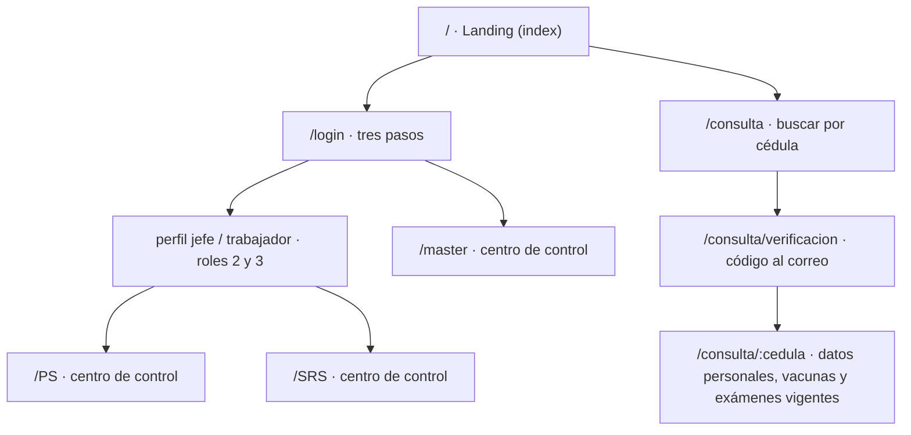
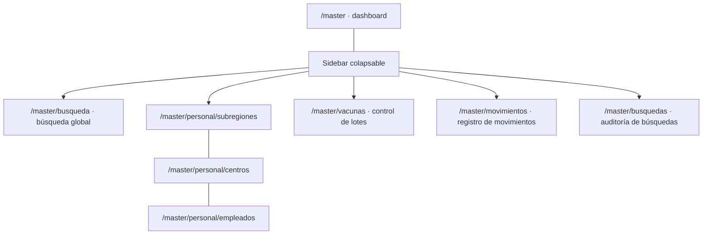

# Vistas y navegación

Última actualización: 2026-10-25
Estado: **borrador** derivado de los bocetos a mano.

> **Aviso:** buena parte de lo que muestra cada pantalla (columnas, campos, filtros, métricas) depende de un
> esquema de base de datos que **todavía no está definido**. Aquí se describe el _comportamiento_ de las vistas y
> se marca qué datos consumen; los campos concretos viven en [`modelo-datos-preliminar.md`](./modelo-datos-preliminar.md)
> y son hipótesis, no un contrato.

## 1. Cómo leer este documento

- Alcance: **solo vistas y navegación**. Sin backend, sin autenticación real, sin guards ni permisos efectivos.
- Cada vista trae su ruta propuesta, su origen (imagen), qué muestra, cómo se comporta y qué queda pendiente.
- Lo que no está dibujado se marca como _(deducido)_ o directamente como _pendiente_. No se inventan pantallas.
- Las decisiones ya tomadas y lo que sigue abierto están en la [sección 10](#10-decisiones).
- Convención de roles usada en los bocetos: `0` ciudadano, `1` master/autoridades, `2` personal de salud,
  `3` subregión de salud.

## 2. Fuente de las imágenes

Los bocetos estaban en `C:\Users\Si\OneDrive\Desktop\edward` y se copiaron al repo para que este documento no
dependa de una ruta local. Peso total: ~4.9 MB.

| Archivo                                             | Carpeta                                     | Aporta                                                |
| --------------------------------------------------- | ------------------------------------------- | ----------------------------------------------------- |
| `diagrama-1.png`                                    | `imagenes/diagramas-descriptivos/`          | Árbol de usuarios y roles (0–3) con sus capacidades   |
| `diagrama-autoridades.png`                          | `imagenes/diagramas-descriptivos/`          | Alcance del master: vigilancia y registros generales  |
| `diagrama-personalsalud.png`                        | `imagenes/diagramas-descriptivos/`          | Jefes vs. personal operativo                          |
| `diagrama-subregiones.png`                          | `imagenes/diagramas-descriptivos/`          | Alcance de la subregión: centros, stock, certificados |
| `diagrama-usuarios.png`                             | `imagenes/diagramas-descriptivos/`          | Ciudadano: sin login, consulta y certificados         |
| `datos-roles.png`                                   | `imagenes/datos-roles/`                     | Boceto de tablas: personal, centros, perfiles, master |
| `datos-usuarios.png`                                | `imagenes/datos-roles/`                     | Ficha del ciudadano y catálogo de exámenes/vacunas    |
| `estructura-inicial.png`                            | `imagenes/estructura-vistas/`               | Navegación raíz: index, login, consulta pública       |
| `vista-inicial.png`                                 | `imagenes/estructura-vistas/vistas-master/` | Dashboard del master                                  |
| `vista-panel-desplegado.png`                        | `imagenes/estructura-vistas/vistas-master/` | Sidebar del master desplegado                         |
| `vista-busqueda.png`                                | `imagenes/estructura-vistas/vistas-master/` | Panel de búsqueda con filtros                         |
| `vista-controlVacunas.png`                          | `imagenes/estructura-vistas/vistas-master/` | Control de lotes de vacunas                           |
| `vista-subregionesPersonal-subregiones-default.png` | `imagenes/estructura-vistas/vistas-master/` | Switch de administración de personal (estado vacío)   |
| `vista-subregionesPersonal-subregiones.png`         | `imagenes/estructura-vistas/vistas-master/` | Tabla de subregiones                                  |
| `vista-subregionesPersonal-buscarCentros.png`       | `imagenes/estructura-vistas/vistas-master/` | Búsqueda de centros de salud                          |
| `vista-subregionesPersonal-buscarEmpleados.png`     | `imagenes/estructura-vistas/vistas-master/` | Búsqueda de empleados                                 |

## 3. Mapa de navegación

- `index` es la **landing page** y convive con dos accesos: login (roles 1–3) y consulta pública (rol 0).
- El ciudadano **no pasa por `/login`**: entra por cédula y código de verificación al correo.
- Los roles 2 y 3 pasan por **dos niveles de credenciales**: primero la cuenta de la entidad (centro o subregión) y
  después el perfil de trabajo (jefe o trabajador). El master entra directo con su cuenta.
- Los tres roles internos aterrizan en un "centro de control" (dashboard). Es el mismo concepto con datos distintos.

### 3.1 Navegación interna del master

Las tres pestañas de administración de personal son **vistas distintas bajo la misma pantalla** (switch), no
páginas independientes en el sidebar.

## 4. Roles y alcance

| Rol | Nombre en bocetos    | Prefijo URL | Shell   | Capacidades dibujadas                                                                                                                                                                                                                                   |
| --- | -------------------- | ----------- | ------- | ------------------------------------------------------------------------------------------------------------------------------------------------------------------------------------------------------------------------------------------------------- |
| 0   | Ciudadanos           | — (público) | ninguno | Consultar su información (vacunas, exámenes), solicitar y recibir certificados, ver centros por estado/municipio/parroquia. **No inicia sesión**                                                                                                        |
| 1   | Autoridades / Master | `/master`   | propio  | Ver todo: logs, búsquedas, usuarios activos. Crear usuarios. Vigilar movimientos de subregiones y personal. Revisar registros generales (lotes entregados, ciudadanos, incidencias, personal) con búsqueda y filtros                                    |
| 2   | Personal de salud    | `/PS`       | propio  | **Jefes:** gestionar acceso del personal, ver métricas del centro y de cada trabajador. **Personal:** registrar personas, acceder a registros, registrar vacunaciones. Ambos perfiles son creados por el master                                         |
| 3   | Subregión de salud   | `/SRS`      | propio  | Una por estado. Gestionar los centros de su estado, contabilizar stock entregado, acceder a registros médicos (exámenes, vacunas, información esencial) para **autorizar o descartar** certificados de salud, revisar información general de ciudadanos |

Observaciones:

- Los roles se persisten como números del `0` al `3` (decisión 12); el `0` no tiene cuenta ni sesión.
- El ciudadano se modela como rol 0 para el árbol de usuarios, pero funcionalmente es un flujo público sin sesión.
- Jefe y trabajador son **tipos de empleado**, no roles nuevos: los dos caen en el mismo prefijo del rol. El jefe
  administra la cuenta y crea los perfiles internos de sus trabajadores (decisión 13).
- La subregión (rol 3) también tiene perfiles internos de jefe y trabajador: primero se valida la cuenta de la
  entidad y después la credencial del perfil (decisión 15).

## 5. Rutas propuestas

| Ruta                           | Vista                                             | Rol     | Boceto                                    | Estado              |
| ------------------------------ | ------------------------------------------------- | ------- | ----------------------------------------- | ------------------- |
| `/`                            | Landing                                           | público | `estructura-inicial`                      | implementado        |
| `/consulta`                    | Buscar ciudadano por cédula                       | público | `estructura-inicial`                      | placeholder         |
| `/consulta/verificacion`       | Código enviado al correo                          | público | `estructura-inicial`                      | bocetado            |
| `/consulta/:cedula`            | Ficha del ciudadano (vacunas y exámenes vigentes) | público | `estructura-inicial`, `diagrama-usuarios` | bocetado            |
| `/login`                       | Login en tres pasos                               | público | `estructura-inicial`                      | implementado        |
| `/master`                      | Centro de control                                 | 1       | `vista-inicial`                           | bocetado            |
| `/master/busqueda`             | Búsqueda global con filtros                       | 1       | `vista-busqueda`                          | bocetado            |
| `/master/vacunas`              | Control de vacunas                                | 1       | `vista-controlVacunas`                    | bocetado            |
| `/master/vacunas/buscar`       | Buscar lotes por filtros                          | 1       | `vista-controlVacunas`                    | deducido            |
| `/master/personal`             | Administración de personal (switch)               | 1       | `…-default`                               | bocetado            |
| `/master/personal/subregiones` | Tabla de subregiones                              | 1       | `…-subregiones`                           | bocetado            |
| `/master/personal/centros`     | Búsqueda de centros                               | 1       | `…-buscarCentros`                         | bocetado            |
| `/master/personal/empleados`   | Búsqueda de empleados                             | 1       | `…-buscarEmpleados`                       | bocetado            |
| `/master/movimientos`          | Registro de movimientos (logs)                    | 1       | `diagrama-autoridades`, sidebar           | pendiente de diseño |
| `/master/busquedas`            | Auditoría de búsquedas de usuarios                | 1       | `diagrama-autoridades`                    | pendiente de diseño |
| `/PS`                          | Centro de control                                 | 2       | —                                         | placeholder         |
| `/SRS`                         | Centro de control                                 | 3       | —                                         | placeholder         |
| `/SRS/personal`                | Administración de personal (layout propio)        | 3       | —                                         | pendiente de diseño |

`/master`, `/PS`, `/SRS` y `/consulta` ya existen con una página provisional (ver secciones 6.3 y 9); el estado de la
tabla describe el diseño de la vista real. Rutas todavía sin boceto (ver
[sección 8](#8-inventario-de-pantallas)): usuarios activos, centros y stock de la subregión, métricas de jefes,
formularios de alta y la vista de certificado.

Los segmentos `PS` y `SRS` van en mayúsculas literales, tanto en `path` como en `routerLink`.

## 6. Vistas

### 6.1 Landing `/`

- Origen: `estructura-inicial.png` (el nodo `index` apunta a "Index sería la landing page").
- Contenido: presentación del sistema y dos accesos claros: **iniciar sesión** e **iniciar consulta por cédula**.
- El boceto no define el contenido visual de la landing: la implementación actual usa un hero, un panel con los
  tres niveles de gestión y tres rasgos del sistema (registro, vacunas y consulta).
- Deducción: debe ser la única pantalla pública con navegación propia; no comparte shell con ningún rol.

### 6.2 Consulta ciudadana (flujo público de tres pasos)

Origen: `estructura-inicial.png` y `diagrama-usuarios.png`.

**Paso 1 — `/consulta`**

- Caja de búsqueda con un único campo: **cédula**.
- Acción: "buscar". Si la cédula no existe o el correo no está registrado, no se revela cuál de las dos cosas falló.
- El ciudadano no se autentica: la verificación es el paso 2.

**Paso 2 — `/consulta/verificacion`**

- Se envía un **código de verificación al correo** registrado del ciudadano.
- El código es **obligatorio**: sirve para que el ciudadano demuestre que realmente es el dueño de los datos que
  pide (decisión 2). Sin código no se muestra la ficha.
- Pantalla para ingresar el código, con reenvío y expiración (deducido; la duración queda por definir).
- Sin backend no se puede enviar correo real: en esta etapa el código se simula.

**Paso 3 — `/consulta/:cedula`**

- Paneles con: **datos personales**, **vacunas vigentes** y **exámenes vigentes**.
- Solo lectura. Desde aquí el ciudadano también puede **solicitar y recibir certificados de salud** (según el
  diagrama de usuarios) y ver **centros de salud por estado, municipio y parroquia** (rama punteada del boceto).
- La ficha es la misma información que ve el personal, pero filtrada: el ciudadano no debe ver datos internos
  (personal que lo atendió, estados de lote, incidencias).

Diseño pendiente: no hay boceto de esta pantalla más allá del listado de bloques.

### 6.3 Login `/login`

Origen: `estructura-inicial.png`. Implementado en `publico/login/`.

Flujo en tres pasos:

1. **Tipo de cuenta** (roles 1, 2 y 3). No muestra el rol 0.
2. **Credenciales de la entidad**: correo y contraseña. En el master esta cuenta es personal; en los roles 2 y 3
   identifica al centro o a la subregión, no a una persona.
3. **Perfil de trabajo** (solo roles 2 y 3): se elige jefe o trabajador y se validan las credenciales propias de ese
   perfil. La sesión no se crea hasta completar este paso.

- Jefes y trabajadores existen en los **dos roles con cuenta de entidad**: centros de salud y subregiones
  (decisión 15).
- No valida contra backend: usa las cuentas de prueba de `docs/diseno/credenciales-demo.md` y `SesionService`.
- El formulario pide **correo y contraseña** (decisión 16). El nombre de usuario del master queda para la base de
  datos.
- Al entrar, cada rol navega a su prefijo (`/master`, `/PS`, `/SRS`), donde hoy hay una página provisional.
- En desarrollo, el propio login muestra un panel con las credenciales de prueba.

### 6.4 Centro de control del master `/master`

Origen: `vista-inicial.png`.

- Cabecera: **"Bienvenido, {nombre}"**.
- Tres cards, en orden vertical:

| Card | Contenido                                                                     | Comportamiento                                                      |
| ---- | ----------------------------------------------------------------------------- | ------------------------------------------------------------------- |
| 1    | Últimos lotes de vacunas entregados y su status                               | Se despliega un panel al pasar el cursor (nota del boceto)          |
| 2    | Top 10 estados (subregiones) con más vacunaciones registradas **esta semana** | Desplegable                                                         |
| 3    | **Placeholder** del mapa de Venezuela (estado → municipio → parroquia)        | Aparece al hacer scroll; el mapa real queda para una fase posterior |

Notas de diseño:

- El panel de la card 1 se abre por **hover**; en pantallas táctiles eso no existe, así que debe abrirse también
  con clic y con foco de teclado.
- El top 10 es una **agregación semanal**: requiere backend o un mock que la simule con la misma forma.
- El mapa es la pieza más costosa del proyecto (geodatos + SVG interactivo). En esta entrega va **solo un
  placeholder**; el mapa navegable queda para fase posterior (decisión 6).
- La vista scrollea: las cards 1 y 2 arriba, el mapa abajo. No es un dashboard de una sola pantalla.

### 6.5 Sidebar del master

Origen: `vista-panel-desplegado.png` y `vista-inicial.png`.

- Colapsado ocupa una franja estrecha; **se despliega al pasar el cursor** (anotación del boceto) y al hacer clic.
- Al desplegarse, un velo oscurece el contenido de atrás (nota explícita del dibujo). Usar atenuación con tokens
  de Caustica, no un blur nuevo.
- Opciones dibujadas:

| Opción                    | Icono del boceto | Ruta destino                   |
| ------------------------- | ---------------- | ------------------------------ |
| Buscar                    | lupa             | `/master/busqueda`             |
| Ver subregiones de salud  | cruz             | `/master/personal/subregiones` |
| Ver cargamento de vacunas | jeringa          | `/master/vacunas`              |
| Registro de movimientos   | lápiz            | `/master/movimientos`          |
| Cerrar sesión             | salida           | vuelve a `/` o `/login`        |

- El boceto también muestra un icono de ajustes junto a "buscar" (opciones del panel). Su función no está definida.
- La opción "Ver subregiones de salud" apunta a la pestaña de subregiones, no al listado de centros.

### 6.6 Búsqueda global `/master/busqueda`

Origen: `vista-busqueda.png`.

- Título: **Panel de Búsqueda**.
- Bloque de **filtros** en forma de botones/chips:

`nombres` · `apellidos` · `cédula` · `vacunas` · `rango de edad` · `exámenes` · `fecha de registro` · `sexo` ·
`etnia` · `ubicación`

- Cada chip abre una **lista desplegable o una caja de texto** para completar ese filtro (comportamiento indicado
  en el margen del dibujo).
- Botón **buscar**: "solo sirve si tienes al menos 2 filtros" (regla explícita). Debe verse deshabilitado y explicar
  por qué hasta que se cumpla.
- Resultados: lista scrollable si hay muchos, con el **total de coincidencias** visible en algún lado.
- La búsqueda es sobre **ciudadanos** (los filtros son clínicos y demográficos), no sobre personal ni centros.
  Los otros dos buscadores viven dentro de administración de personal.

### 6.7 Control de vacunas `/master/vacunas`

Origen: `vista-controlVacunas.png`.

- Título: **Control de vacunas**.
- Botón **"buscar lotes"** → lleva a una vista con filtros para buscar lotes (ruta deducida `/master/vacunas/buscar`).
- Franja o sección de **lotes en estado "en camino"**.
- Dos bloques **desplegables**: **lotes reportados** y **lotes aceptados**.
- La vista "debe ser larga verticalmente y se debe poder scrollear" (nota explícita).
- No se dibujan columnas de la tabla de lotes: dependen del esquema (ver modelo preliminar).
- Faltan los estados intermedios del ciclo de vida del lote (pregunta 10).

### 6.8 Administración de personal `/master/personal`

Origen: `…-subregiones-default.png`, `…-subregiones.png`, `…-buscarCentros.png`, `…-buscarEmpleados.png`.

**Estructura común**

- Título: **Administración de Personal**.
- **Switch de tres opciones**: `Subregiones` · `buscar centros` · `buscar empleados`.
- Al pulsar una opción **cambia la vista de abajo** (no navega a otra pantalla). Se implementa con `<ca-tabs>`.
- La opción activa se resalta con borde/fondo distinto, según el boceto.
- El estado del switch debería reflejarse en la URL para poder compartir enlaces (deducido).

**6.8.1 Subregiones**

- Tabla con tres columnas: `nombre` · `estado asignado` · `administrador (nombre)`.
- El estado asignado es un estado de Venezuela (ejemplos del margen: Guárico, Caracas).
- Tabla scrollable.
- Al hacer clic en una fila: **detalle de la subregión** con sus datos, la lista de empleados y el jefe.
- Botón **"Agregar…"** → vista con formulario de alta (no dibujado).
- No se dibuja paginación; se asume scroll con muchos registros.

**6.8.2 Buscar centros**

- Vista de búsqueda por filtros: **ubicación** (estado, municipio, parroquia), **nombre**, **número o
  identificación de establecimiento**.
- Cada resultado debe mostrar los **datos del establecimiento** y el **nombre del jefe con su cédula**.
- El resultado invita a abrir la ficha del centro (no dibujada).

**6.8.3 Buscar empleados**

- Vista de búsqueda por: **nombre**, **cédula**, **tipo de empleado** (jefe o trabajador), **ubicación**
  (estado, municipio, parroquia).
- Al hacer clic en un empleado: **vista con sus datos completos** (no dibujada).
- El "tipo de empleado" confirma que jefe y trabajador son un atributo, no roles del sistema (ver 4). Los dos usan
  el rol de su entidad (2 o 3); el jefe crea los perfiles internos de sus trabajadores.

**Alcance**: esta pantalla es **exclusiva del master** (decisión 5). La subregión tiene su propia vista de
administración de personal, con otro layout, todavía sin boceto.

### 6.9 Pantallas mencionadas sin boceto

- **Registro de movimientos / logs** (`/master/movimientos`): es la misma pantalla; "movimientos" y "logs" son
  sinónimos (decisión 7). No hay dibujo de columnas ni filtros.
- **Búsquedas registradas** (`/master/busquedas`): pantalla distinta del registro de movimientos. Lista las
  consultas de usuarios que hacen los roles internos (decisión 7).
- **Centro de control del personal de salud**: métricas del centro y de cada trabajador (jefe) vs. tareas operativas
  (personal). Sin dibujo.
- **Centro de control de la subregión**: stock entregado, centros del estado, certificados emitidos. Sin dibujo.
- **Formularios de alta**: subregión, centro, empleado, usuario. Solo se dibuja el botón "Agregar…".
- **Detalle de subregión, de centro y de empleado**: se dibuja la transición, no el contenido.
- **Vista del certificado de salud**: se menciona en tres diagramas, no se dibuja.
- **Autorización de certificados** (rol 3): bandeja de solicitudes para autorizar o descartar la emisión. Sin boceto.

## 7. Patrones de UI recurrentes

Son los que conviene construir una sola vez en `compartido/ui` en lugar de repetir por rol:

| Patrón                                      | Dónde aparece                        | Nota de implementación                                                  |
| ------------------------------------------- | ------------------------------------ | ----------------------------------------------------------------------- |
| Shell con sidebar colapsable y velo         | Master (y probablemente PS/SRS)      | Hover + clic + foco; el velo es atenuación, no otra superficie con blur |
| Cabecera "Bienvenido, {nombre}"             | `/master`, centros de control        | Requiere el nombre del usuario de sesión                                |
| Chip de filtro que abre popover             | Búsqueda global, centros, empleados  | Un componente con dos modos: lista desplegable o caja de texto          |
| Tabla scrollable con contador de resultados | Subregiones, resultados de búsqueda  | Encabezado fijo; paginación solo si el volumen lo exige                 |
| Card desplegable                            | Lotes reportados/aceptados, top 10   | `<ca-collapse>`                                                         |
| Switch de vistas                            | Administración de personal           | `<ca-tabs>`                                                             |
| Estado vacío y estado de carga              | Todas las tablas y búsquedas         | No dibujados; definirlos antes de implementar                           |
| Vista larga con scroll                      | Dashboard (mapa), control de vacunas | Anotado explícitamente en los bocetos                                   |

Reglas de la casa que aplican: reutilizar `<ca-*>` cuando exista el elemento, tokens de Caustica para color/blur/
borde, y no anidar superficies con blur.

## 8. Inventario de pantallas

Prioridad sugerida: primero lo que ya tiene boceto y no depende del esquema de BD.

| #   | Pantalla                        | Rol     | Tiene boceto | Depende de BD         | Prioridad |
| --- | ------------------------------- | ------- | ------------ | --------------------- | --------- |
| 1   | Landing (implementada)          | público | No           | No                    | Alta      |
| 2   | Login en 3 pasos (implementado) | público | Sí           | No                    | Alta      |
| 3   | Consulta: cédula                | público | Sí           | Sí (campos)           | Alta      |
| 4   | Consulta: verificación          | público | Sí           | No                    | Alta      |
| 5   | Consulta: ficha                 | público | Parcial      | Sí                    | Media     |
| 6   | Dashboard master                | 1       | Sí           | Sí (lotes, agregados) | Alta      |
| 7   | Sidebar master                  | 1       | Sí           | No                    | Alta      |
| 8   | Búsqueda global                 | 1       | Sí           | Sí                    | Media     |
| 9   | Control de vacunas              | 1       | Sí           | Sí                    | Media     |
| 10  | Admin. personal: subregiones    | 1       | Sí           | Sí                    | Media     |
| 11  | Admin. personal: centros        | 1       | Sí           | Sí                    | Media     |
| 12  | Admin. personal: empleados      | 1       | Sí           | Sí                    | Media     |
| 13  | Registro de movimientos         | 1       | No           | Sí                    | Baja      |
| 14  | Dashboard personal de salud     | 2       | No           | Sí                    | Media     |
| 15  | Dashboard subregión             | 3       | No           | Sí                    | Media     |
| 16  | Formularios de alta (x4)        | 1 / 3   | No           | Sí                    | Baja      |
| 17  | Placeholder del mapa            | 1       | Sí           | No                    | Media     |
| 18  | Certificado de salud            | 0 / 3   | No           | Sí                    | Baja      |
| 19  | Admin. personal (subregión)     | 3       | No           | Sí                    | Media     |
| 20  | Mapa interactivo (fase 2)       | 1       | Sí           | Sí + geodatos         | Baja      |

## 9. Notas de implementación

- **Rutas**: `app.routes.ts` solo compone. El flujo público (landing, login, consulta) se declara ahí; cada rol
  entra con `loadChildren` desde su `*.routes.ts`.
- **Consulta pública**: vive en `publico/`, no en `roles/`. No tiene shell, así que no puede depender de nada de
  `roles/*/shell`.
- **Shells**: el sidebar dibujado es del master. La subregión tiene su propio layout de administración de personal,
  así que ese bloque no se comparte; evaluar un shell común solo cuando se dibujen PS y SRS.
- **Catálogos**: `nucleo/modelos/catalogo.ts`, `nucleo/datos/catalogos.ts` y `nucleo/servicios/catalogos.service.ts`
  ya tienen las listas temporales (vacunas, profesiones, grados, etnias, tipos de establecimiento, tipos de sangre).
  Las vistas las piden al servicio; no se importan los arrays.
- **Datos**: las vistas consumen servicios con `signal`; los arrays mock viven en `nucleo/datos` y nadie los importa
  directo. Mientras el esquema no exista, los tipos de `nucleo/modelos` se marcan como provisionales.
- **Sesión simulada**: `nucleo/modelos/cuenta-acceso.ts`, `nucleo/datos/cuentas-acceso.ts` y
  `nucleo/servicios/sesion.service.ts`. La landing, el login y las páginas provisionales de cada rol ya navegan con
  ese servicio; reemplazarlo por la API no debe cambiar las plantillas.
- **Páginas provisionales**: `compartido/ui/pagina-en-construccion/` muestra el nombre y la entidad de la sesión y
  permite cerrarla. Es el destino temporal de `/master`, `/PS`, `/SRS` y `/consulta`.
- **Riesgo principal**: tipar `CentroSalud`, `Lote` o `Ciudadano` demasiado pronto y reescribir medio proyecto cuando
  llegue la base de datos. Mitigación: los servicios exponen vistas de datos mínimas (lo que la pantalla necesita)
  y el mapeo desde la entidad real se hace en una sola capa.
- **Volumen**: tablas de subregiones, centros y empleados pueden crecer; el scroll simple del boceto es suficiente
  para la etapa de vistas, pero la tabla debe aislarse para poder virtualizarla después.
- **Accesibilidad**: el sidebar por hover y el panel de la card 1 por hover necesitan también clic y teclado.

## 10. Decisiones

Decisiones vigentes del prototipo. Las 14 preguntas de la primera revisión quedaron resueltas y se suman las
decisiones de implementación 15 y 16.

| #   | Decisión                                                                                                                                                                        |
| --- | ------------------------------------------------------------------------------------------------------------------------------------------------------------------------------- |
| 1   | La subregión **autoriza o descarta** la emisión del certificado de salud. No hay aprobación examen por examen; el estado pertenece al certificado, no al examen.                |
| 2   | El código de verificación es **obligatorio**: demuestra que quien consulta es el dueño de los datos.                                                                            |
| 3   | `Enferm.` son las **cuentas de los enfermeros trabajadores**, subordinados de los perfiles de tipo 2. Esa imagen es un prototipo de las tablas de usuarios.                     |
| 4   | El master tiene **nombre de usuario**, correo y contraseña. El personal también tiene contraseña.                                                                               |
| 5   | La administración de personal es **solo del master**. La subregión tiene su propia vista, con otro layout.                                                                      |
| 6   | El mapa de Venezuela va como **placeholder** por ahora.                                                                                                                         |
| 7   | "Registro de movimientos" y "logs" son la misma pantalla. "Búsquedas" es una pantalla aparte, para auditar consultas de usuarios.                                               |
| 8   | Los requisitos del certificado son los campos de `datos-usuarios.png`: los exámenes y vacunas dibujados ahí, sin agregar otros.                                                 |
| 9   | Los catálogos serán tablas propias cuando exista la base de datos. Por ahora viven en código, con datos reales de referencia.                                                   |
| 10  | Solo hay **tres estados de lote** (`en_camino`, `reportado`, `aceptado`). Los cambia el master; idealmente, los usuarios de tipo 3.                                             |
| 11  | El detalle de los datos sensibles lo ve cualquier usuario interno; el público (tipo 0) no.                                                                                      |
| 12  | Los roles se guardan como **0–3**.                                                                                                                                              |
| 13  | Jefe y trabajador son un **campo** (`tipo_empleado`), no roles: los dos caen en el mismo prefijo. El jefe administra la cuenta y crea perfiles de trabajadores (rol 2 y rol 3). |
| 14  | El top 10 se calcula por **semana calendario**.                                                                                                                                 |
| 15  | Los roles 2 y 3 inician sesión en **dos niveles**: credenciales de la entidad y luego credenciales propias del perfil (jefe o trabajador).                                      |
| 16  | El login usa **correo y contraseña**, también para el master. La validación es simulada hasta que exista backend.                                                               |

### Sigue abierto

- Duración y reenvío del código de verificación (detalle de implementación).
- Regla de vigencia de exámenes y vacunas: sin ella no se puede decidir si un certificado es emitible.
- Cómo se guardan las credenciales reales (hash, recuperación, bloqueo por intentos) cuando exista backend.
- Fuente de los geodatos para el mapa (estados, municipios y parroquias).
- Catálogo definitivo de pueblos indígenas (la lista actual es de trabajo).
