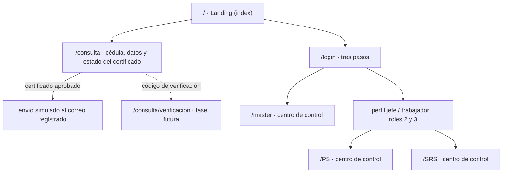
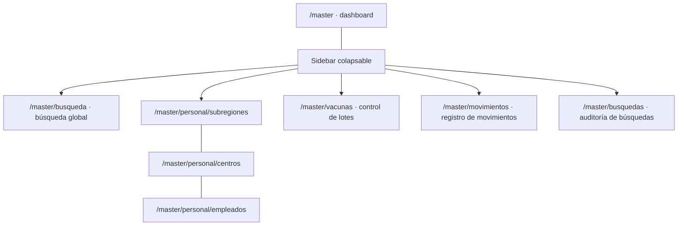

# Vistas y navegación

Última actualización: 2026-10-25
Estado: **borrador** derivado de los bocetos a mano.

> **Aviso:** el 2026-10-25 se recibió un esquema de base de datos **parcial**
> ([`db_schema.sql`](../referencias/db_schema.sql)). Aquí se describe el _comportamiento_ de las vistas y
> qué datos consumen; la correspondencia con las tablas reales, los huecos y las preguntas abiertas están
> en [`modelo-datos.md`](./modelo-datos.md). El modelo preliminar quedó como documento histórico.

## 1. Cómo leer este documento

- Alcance: **solo vistas y navegación**. Sin backend, sin autenticación real, sin guards ni permisos efectivos.
- Cada vista trae su ruta propuesta, su origen (imagen), qué muestra, cómo se comporta y qué queda pendiente.
- Lo que no está dibujado se marca como _(deducido)_ o directamente como _pendiente_. No se inventan pantallas.
- Las decisiones ya tomadas y lo que sigue abierto están en la [sección 10](#10-decisiones).
- Convención de roles usada en los bocetos: `0` ciudadano, `1` master/autoridades, `2` personal de salud,
  `3` subregión de salud.

## 2. Fuente de las imágenes

Los bocetos estaban en `C:\Users\Si\OneDrive\Desktop\edward` y se copiaron al repo para que este documento no
dependa de una ruta local. Peso total: ~4.9 MB.

| Archivo                                             | Carpeta                                     | Aporta                                                |
| --------------------------------------------------- | ------------------------------------------- | ----------------------------------------------------- |
| `diagrama-1.png`                                    | `imagenes/diagramas-descriptivos/`          | Árbol de usuarios y roles (0–3) con sus capacidades   |
| `diagrama-autoridades.png`                          | `imagenes/diagramas-descriptivos/`          | Alcance del master: vigilancia y registros generales  |
| `diagrama-personalsalud.png`                        | `imagenes/diagramas-descriptivos/`          | Jefes vs. personal operativo                          |
| `diagrama-subregiones.png`                          | `imagenes/diagramas-descriptivos/`          | Alcance de la subregión: centros, stock, certificados |
| `diagrama-usuarios.png`                             | `imagenes/diagramas-descriptivos/`          | Ciudadano: sin login, consulta y certificados         |
| `datos-roles.png`                                   | `imagenes/datos-roles/`                     | Boceto de tablas: personal, centros, perfiles, master |
| `datos-usuarios.png`                                | `imagenes/datos-roles/`                     | Ficha del ciudadano y catálogo de exámenes/vacunas    |
| `estructura-inicial.png`                            | `imagenes/estructura-vistas/`               | Navegación raíz: index, login, consulta pública       |
| `vista-inicial.png`                                 | `imagenes/estructura-vistas/vistas-master/` | Dashboard del master                                  |
| `vista-panel-desplegado.png`                        | `imagenes/estructura-vistas/vistas-master/` | Sidebar del master desplegado                         |
| `vista-busqueda.png`                                | `imagenes/estructura-vistas/vistas-master/` | Panel de búsqueda con filtros                         |
| `vista-controlVacunas.png`                          | `imagenes/estructura-vistas/vistas-master/` | Control de lotes de vacunas                           |
| `vista-subregionesPersonal-subregiones-default.png` | `imagenes/estructura-vistas/vistas-master/` | Switch de administración de personal (estado vacío)   |
| `vista-subregionesPersonal-subregiones.png`         | `imagenes/estructura-vistas/vistas-master/` | Tabla de subregiones                                  |
| `vista-subregionesPersonal-buscarCentros.png`       | `imagenes/estructura-vistas/vistas-master/` | Búsqueda de centros de salud                          |
| `vista-subregionesPersonal-buscarEmpleados.png`     | `imagenes/estructura-vistas/vistas-master/` | Búsqueda de empleados                                 |

## 3. Mapa de navegación

- `index` es la **landing page** y convive con dos accesos: login (roles 1–3) y consulta pública (rol 0).
- El ciudadano **no pasa por `/login`**: entra por `/consulta`, busca su cédula y ve el resultado en la misma
  página. En esta etapa **no se pide código de verificación**; el envío del certificado es simulado. El paso por
  `/consulta/verificacion` queda como fase futura.
- Los roles 2 y 3 pasan por **dos niveles de credenciales**: primero la cuenta de la entidad (centro o subregión) y
  después el perfil de trabajo (jefe o trabajador). El master entra directo con su cuenta. La cuenta de entidad se
  resuelve con la tabla propuesta `cuentas_entidad`; los perfiles son filas de `personal`. Ver
  [`modelo-datos.md`](./modelo-datos.md) §5.1.
- Los tres roles internos aterrizan en un "centro de control" (dashboard). Es el mismo concepto con datos distintos.

### 3.1 Navegación interna del master

Las tres pestañas de administración de personal son **vistas distintas bajo la misma pantalla** (switch), no
páginas independientes en el sidebar.

## 4. Roles y alcance

| Rol | Nombre en bocetos    | Prefijo URL | Shell   | Capacidades dibujadas                                                                                                                                                                                                                                   |
| --- | -------------------- | ----------- | ------- | ------------------------------------------------------------------------------------------------------------------------------------------------------------------------------------------------------------------------------------------------------- |
| 0   | Ciudadanos           | — (público) | ninguno | Consultar su información (vacunas, exámenes), solicitar y recibir certificados, ver centros por estado/municipio/parroquia. **No inicia sesión**                                                                                                        |
| 1   | Autoridades / Master | `/master`   | propio  | Ver todo: logs, búsquedas, usuarios activos. Crear usuarios. Vigilar movimientos de subregiones y personal. Revisar registros generales (lotes entregados, ciudadanos, incidencias, personal) con búsqueda y filtros                                    |
| 2   | Personal de salud    | `/PS`       | propio  | **Jefes:** gestionar acceso del personal, ver métricas del centro y de cada trabajador. **Personal:** registrar personas, acceder a registros, registrar vacunaciones. Ambos perfiles son creados por el master                                         |
| 3   | Subregión de salud   | `/SRS`      | propio  | Una por estado. Gestionar los centros de su estado, contabilizar stock entregado, acceder a registros médicos (exámenes, vacunas, información esencial) para **autorizar o descartar** certificados de salud, revisar información general de ciudadanos |

Observaciones:

- Los roles se persisten como números del `0` al `3` (decisión 12); el `0` no tiene cuenta ni sesión.
- El ciudadano se modela como rol 0 para el árbol de usuarios, pero funcionalmente es un flujo público sin sesión.
- Jefe y trabajador son **tipos de empleado**, no roles nuevos: los dos caen en el mismo prefijo del rol. En la
  simulación actual el jefe administra la cuenta y crea los perfiles internos de sus trabajadores (decisión 13); el
  esquema real no tiene tabla de perfiles y los representa como filas de `personal`. Hay un solo jefe por centro,
  derivado de `centros_salud.encargado_id`.
- La subregión (rol 3) también tiene perfiles internos de jefe y trabajador: primero se valida la cuenta de la
  entidad en `cuentas_entidad` (propuesta) y después la credencial del perfil en `personal` (decisión 15). El esquema
  real la representa como una **sede dentro de `centros_salud`** con un campo `tipo`, no como tabla aparte; su
  personal es `personal.tipo_cuenta = 3` con `centro_id` apuntando a esa sede.

## 5. Rutas propuestas

| Ruta                           | Vista                                              | Rol     | Boceto                                    | Estado              |
| ------------------------------ | -------------------------------------------------- | ------- | ----------------------------------------- | ------------------- |
| `/`                            | Landing                                            | público | `estructura-inicial`                      | implementado        |
| `/consulta`                    | Buscar por cédula, datos y certificado             | público | `estructura-inicial`                      | implementado (mock) |
| `/consulta/verificacion`       | Código enviado al correo (fase futura)             | público | `estructura-inicial`                      | no implementado     |
| `/consulta/:cedula`            | Ficha pública del ciudadano (fase futura)          | público | `estructura-inicial`, `diagrama-usuarios` | no implementado     |
| `/login`                       | Login en tres pasos                                | público | `estructura-inicial`                      | implementado        |
| `/master`                      | Centro de control                                  | 1       | `vista-inicial`                           | implementado (mock) |
| `/master/busqueda`             | Búsqueda global con filtros                        | 1       | `vista-busqueda`                          | implementado (mock) |
| `/master/vacunas`              | Control de vacunas                                 | 1       | `vista-controlVacunas`                    | implementado (mock) |
| `/master/vacunas/buscar`       | Buscar lotes por filtros                           | 1       | `vista-controlVacunas`                    | implementado (mock) |
| `/master/personal`             | Administración de personal (switch)                | 1       | `…-default`                               | implementado (mock) |
| `/master/personal/subregiones` | Tabla de subregiones                               | 1       | `…-subregiones`                           | implementado (mock) |
| `/master/personal/centros`     | Búsqueda de centros                                | 1       | `…-buscarCentros`                         | implementado (mock) |
| `/master/personal/empleados`   | Búsqueda de empleados                              | 1       | `…-buscarEmpleados`                       | implementado (mock) |
| `/master/movimientos`          | Registro de movimientos (logs)                     | 1       | `diagrama-autoridades`, sidebar           | implementado (mock) |
| `/master/busquedas`            | Auditoría de búsquedas de usuarios                 | 1       | `diagrama-autoridades`                    | implementado (mock) |
| `/PS`                          | Centro de control                                  | 2       | —                                         | implementado (mock) |
| `/SRS`                         | Centro de control                                  | 3       | —                                         | implementado (mock) |
| `/SRS/trabajadores`            | Consulta del personal tipo 2 del estado            | 3       | —                                         | implementado (mock) |
| `/SRS/trabajadores/:id`        | Ficha del trabajador                               | 3       | —                                         | implementado (mock) |
| `/SRS/ciudadanos`              | Búsqueda de ciudadanos del estado                  | 3       | —                                         | implementado (mock) |
| `/SRS/ciudadanos/:id`          | Ficha ciudadana con vacunas, exámenes y requisitos | 3       | —                                         | implementado (mock) |
| `/SRS/certificados`            | Bandeja de certificados                            | 3       | —                                         | implementado (mock) |
| `/SRS/certificados/:id`        | Revisión, autorización y emisión de certificados   | 3       | —                                         | implementado (mock) |
| `/SRS/notificaciones`          | Solicitudes completas listas para revisión         | 3       | —                                         | implementado (mock) |

Las rutas de detalle del master (`/master/personal/subregiones/:id`, `/master/personal/centros/:id` y
`/master/personal/empleados/:id`) también están implementadas con datos mock, igual que los formularios de alta
simulados de subregiones, centros y empleados.

`/consulta` ya está implementada con mocks y muestra los datos personales y el estado del certificado en la misma
página. El master, `/PS` y `/SRS` consumen `DatosMasterService`, `DatosPersonalSaludService` y
`DatosSubregionSaludService` con los mocks de `nucleo/datos/master.ts`, `nucleo/datos/personal-salud.ts` y
`nucleo/datos/subregion-salud.ts`. La subregión incluye consulta de personal, ficha ciudadana, bandeja de certificados
y notificaciones; el envío del certificado se simula desde la consulta pública. Las rutas todavía sin boceto (ver
[sección 8](#8-inventario-de-pantallas)): usuarios activos, stock y movimientos de la subregión, métricas de jefes,
formularios reales de alta y la entrega real del certificado.

Los segmentos `PS` y `SRS` van en mayúsculas literales, tanto en `path` como en `routerLink`.

El esquema de trabajo ya define ciudadanía (`usuarios`), personal (`personal`), centros (`centros_salud`), geografía,
catálogos clínicos y las tablas propuestas de certificados, notificaciones y envíos. Lotes, movimientos, búsquedas e
incidencias todavía no tienen tabla; su diseño queda en espera. La correspondencia completa está en
[`modelo-datos.md`](./modelo-datos.md) §3–§5.

## 6. Vistas

### 6.1 Landing `/`

- Origen: `estructura-inicial.png` (el nodo `index` apunta a "Index sería la landing page").
- Contenido: presentación del sistema y dos accesos claros: **iniciar sesión** e **iniciar consulta por cédula**.
- El boceto no define el contenido visual de la landing: la implementación actual usa un hero, un panel con los
  tres niveles de gestión y tres rasgos del sistema (registro, vacunas y consulta).
- Deducción: debe ser la única pantalla pública con navegación propia; no comparte shell con ningún rol.

### 6.2 Consulta ciudadana `/consulta`

Origen: `estructura-inicial.png` y `diagrama-usuarios.png`. Implementada en `publico/consulta/`.

En esta etapa la consulta es **de un solo paso**: el ciudadano escribe la cédula y el resultado aparece debajo del
buscador, sin cambiar de ruta. La app no pide código de verificación y no envía correo real.

- Caja de búsqueda con un único campo: **cédula**. En el esquema de trabajo es `usuarios.cedula` (`BIGINT`,
  `UNIQUE`); la entrada se normaliza a dígitos.
- Si la cédula no existe, se muestra un mensaje genérico. No se revela si el problema es la cédula o el correo.
- El resultado muestra:
  - identidad: nombre, cédula, edad, sexo y ubicación;
  - datos personales: nacimiento, etnia, correo, teléfono, residencia y fecha de alta;
  - estado del certificado: `solicitado`, `autorizado`, `descartado` o `emitido`;
  - resumen clínico: cantidad de vacunas, cantidad de exámenes y requisitos cumplidos. **No** muestra lote, centro
    de vacunación ni el detalle de exámenes sensibles (VIH/VDRL, decisión 11).
- Si el certificado está `autorizado` o `emitido`, aparece el botón **Enviar certificado a mi correo**. La acción
  registra un envío **simulado** en `DatosSubregionSaludService`; no hay correo, PDF ni código de verificación.
- Si el certificado está `solicitado` o `descartado`, el botón no aparece. La vista explica el estado y, en el caso
  descartado, muestra el motivo registrado.
- En el esquema de trabajo, la ficha corresponde a `usuarios`, `tipoSangre`, `etnias`, `profesiones`,
  `usuario_telefonos`, `usuario_residencias` + geografía, `usuario_vacunas` + `vacunas`, `usuario_examenes` +
  `examenes` y `certificados_salud` + `certificado_envios`. La app todavía usa mocks para esas relaciones.
- **Vigencia**: la regla sigue siendo provisional (`VIGENCIA_EXAMENES_MESES` y los campos nuevos de los catálogos).
  La vista advierte que no reemplaza una valoración médica.
- La auditoría de la consulta en `consultas_publicas` está propuesta, pero todavía no se escribe.

**Fase futura, no implementada**: `/consulta/verificacion` con código al correo y `/consulta/:cedula` como ruta
independiente. El código de verificación vuelve a ser obligatorio cuando exista backend y envío real (decisión 2
actualizada).

### 6.3 Login `/login`

Origen: `estructura-inicial.png`. Implementado en `publico/login/`.

Flujo en tres pasos:

1. **Tipo de cuenta** (roles 1, 2 y 3). No muestra el rol 0.
2. **Credenciales de la entidad**: correo y contraseña. En el master se usa la tabla `master`; en los roles 2 y 3
   valida la tabla propuesta `cuentas_entidad`, que identifica al centro o a la subregión.
3. **Perfil de trabajo** (solo roles 2 y 3): se elige jefe o trabajador entre las filas de `personal` del centro y se
   validan las credenciales propias de ese perfil. La sesión no se crea hasta completar este paso.

- Jefes y trabajadores existen en los **dos roles con cuenta de entidad**: centros de salud y subregiones
  (decisión 15). Hay un solo jefe por centro, marcado por `cuentas_entidad.jefe_id` y `centros_salud.encargado_id`.
- No valida contra backend: usa las cuentas de prueba de `docs/diseno/credenciales-demo.md` y `SesionService`.
- El formulario pide **correo y contraseña** (decisión 16). El esquema ya incluye `master.nombre_usuario`, pero el
  login actual sigue usando el correo; el nombre de usuario queda como alternativa para el backend.
- Al entrar, cada rol navega a su prefijo (`/master`, `/PS`, `/SRS`); los tres roles ya tienen sus vistas mock.
- En desarrollo, el propio login muestra un panel con las credenciales de prueba.

> **Esquema real parcial:** `cuentas_entidad` es una **propuesta** y no está en el script. Conserva el login de dos
> niveles: el primero valida la entidad y el segundo el perfil de `personal`; `tipo_cuenta` (2 o 3) debe coincidir con
> el tipo elegido y `centros_salud.tipo` (a agregar) distingue un centro normal de una sede de subregión. Ver
> [`modelo-datos.md`](./modelo-datos.md) §5.1.

### 6.4 Centro de control del master `/master`

Origen: `vista-inicial.png`.

- Cabecera: **"Bienvenido, {nombre}"**.
- Tres cards, en orden vertical:

| Card | Contenido                                                                     | Comportamiento                                                      |
| ---- | ----------------------------------------------------------------------------- | ------------------------------------------------------------------- |
| 1    | Últimos lotes de vacunas entregados y su status                               | Se despliega un panel al pasar el cursor (nota del boceto)          |
| 2    | Top 10 estados (subregiones) con más vacunaciones registradas **esta semana** | Desplegable                                                         |
| 3    | **Placeholder** del mapa de Venezuela (estado → municipio → parroquia)        | Aparece al hacer scroll; el mapa real queda para una fase posterior |

Notas de diseño:

- El panel de la card 1 se abre por **hover**; en pantallas táctiles eso no existe, así que debe abrirse también
  con clic y con foco de teclado.
- El top 10 es una **agregación semanal**: requiere backend o un mock que la simule con la misma forma.
- El mapa es la pieza más costosa del proyecto (geodatos + SVG interactivo). En esta entrega va **solo un
  placeholder**; el mapa navegable queda para fase posterior (decisión 6).
- La vista scrollea: las cards 1 y 2 arriba, el mapa abajo. No es un dashboard de una sola pantalla.

Con el esquema parcial recibido:

- La **card 1** está bloqueada: no hay tabla de lotes/stock. `usuario_vacunas.lote` es un texto de dosis aplicadas,
  no un cargamento con estado y destino.
- La **card 2** se puede calcular con `usuario_vacunas` uniendo `centro_id` → `centros_salud.estado_id` y filtrando
  `fecha_aplicacion` por la semana calendario (decisión 14). El estado hace de subregión.
- La **card 3** tiene la jerarquía `estado → mcpo → parroquia` en tablas; falta cargar los geodatos oficiales.
- La cabecera "Bienvenido, {nombre}" se resuelve con `master.nombre_usuario`. No se agrega un campo `nombre`.

### 6.5 Sidebar del master

Origen: `vista-panel-desplegado.png` y `vista-inicial.png`.

- Colapsado ocupa una franja estrecha; **se despliega al pasar el cursor** (anotación del boceto) y al hacer clic.
- Al desplegarse, un velo oscurece el contenido de atrás (nota explícita del dibujo). Usar atenuación con tokens
  de Caustica, no un blur nuevo.
- Opciones dibujadas:

| Opción                    | Icono del boceto | Ruta destino                   |
| ------------------------- | ---------------- | ------------------------------ |
| Buscar                    | lupa             | `/master/busqueda`             |
| Ver subregiones de salud  | cruz             | `/master/personal/subregiones` |
| Ver cargamento de vacunas | jeringa          | `/master/vacunas`              |
| Registro de movimientos   | lápiz            | `/master/movimientos`          |
| Cerrar sesión             | salida           | vuelve a `/` o `/login`        |

- El boceto también muestra un icono de ajustes junto a "buscar" (opciones del panel). Su función no está definida.
- La opción "Ver subregiones de salud" apunta a la pestaña de subregiones, no al listado de centros.

### 6.6 Búsqueda global `/master/busqueda`

Origen: `vista-busqueda.png`.

- Título: **Panel de Búsqueda**.
- Bloque de **filtros** en forma de botones/chips:

`nombres` · `apellidos` · `cédula` · `vacunas` · `rango de edad` · `exámenes` · `fecha de registro` · `sexo` ·
`etnia` · `ubicación`

- Cada chip abre una **lista desplegable o una caja de texto** para completar ese filtro (comportamiento indicado
  en el margen del dibujo).
- Botón **buscar**: "solo sirve si tienes al menos 2 filtros" (regla explícita). Debe verse deshabilitado y explicar
  por qué hasta que se cumpla.
- Resultados: lista scrollable si hay muchos, con el **total de coincidencias** visible en algún lado.
- La búsqueda es sobre **ciudadanos** (los filtros son clínicos y demográficos), no sobre personal ni centros.
  Los otros dos buscadores viven dentro de administración de personal.

Correspondencia con el esquema parcial: nombres, apellidos, cédula, nacimiento, vacunas, exámenes, etnia, ubicación y
fecha de registro salen de `usuarios`, `usuario_vacunas`, `usuario_examenes`, `etnias`, `usuario_residencias` y
`usuarios.creado_en`. **Sexo** se agregará a `usuarios`; falta definir su tipo. Con eso se cubren todos los chips
dibujados.

### 6.7 Control de vacunas `/master/vacunas`

Origen: `vista-controlVacunas.png`.

- Título: **Control de vacunas**.
- Botón **"buscar lotes"** → lleva a una vista con filtros para buscar lotes (ruta deducida `/master/vacunas/buscar`).
- Franja o sección de **lotes en estado "en camino"**.
- Dos bloques **desplegables**: **lotes reportados** y **lotes aceptados**.
- La vista "debe ser larga verticalmente y se debe poder scrollear" (nota explícita).
- No se dibujan columnas de la tabla de lotes: dependen de una tabla que **todavía no está en el esquema**.
- Con el esquema parcial solo existe `usuario_vacunas.lote` (texto) por dosis aplicada. Eso no permite mostrar stock,
  estado, destino ni fechas de un cargamento: la vista completa queda bloqueada hasta recibir la tabla de lotes.
- La decisión 10 fija solo tres estados (`en_camino`, `reportado`, `aceptado`); el ciclo de vida del lote se
  implementará cuando exista esa tabla.

### 6.8 Administración de personal `/master/personal`

Origen: `…-subregiones-default.png`, `…-subregiones.png`, `…-buscarCentros.png`, `…-buscarEmpleados.png`.

**Estructura común**

- Título: **Administración de Personal**.
- **Switch de tres opciones**: `Subregiones` · `buscar centros` · `buscar empleados`.
- Al pulsar una opción **cambia la vista de abajo** (no navega a otra pantalla). Se implementa con `<ca-tabs>`.
- La opción activa se resalta con borde/fondo distinto, según el boceto.
- El estado del switch debería reflejarse en la URL para poder compartir enlaces (deducido).

**6.8.1 Subregiones**

- Tabla con tres columnas: `nombre` · `estado asignado` · `administrador (nombre)`.
- En el esquema real son filas de `centros_salud` con `tipo = 3` (a agregar), unidas a `estado` y a `personal` por
  `encargado_id`. Una por estado.
- El estado asignado es un estado de Venezuela (ejemplos del margen: Guárico, Caracas).
- Tabla scrollable.
- Al hacer clic en una fila: **detalle de la subregión** con sus datos, la lista de empleados y el jefe.
- Botón **"Agregar…"** → vista con formulario de alta (no dibujado).
- No se dibuja paginación; se asume scroll con muchos registros.

**6.8.2 Buscar centros**

- Vista de búsqueda por filtros: **ubicación** (estado, municipio, parroquia), **nombre**, **número o
  identificación de establecimiento** (`centros_salud.codigo`).
- En el esquema real son filas de `centros_salud` con `tipo = 2` (a agregar), unidas a geografía.
- Cada resultado debe mostrar los **datos del establecimiento** y el **nombre del jefe con su cédula**; el jefe es
  `centros_salud.encargado_id` → `personal`.
- El resultado invita a abrir la ficha del centro (no dibujada).
- El tipo de establecimiento (hospital, ambulatorio, CDI…) se expresa en el **nombre** del centro: `tipo` solo
  distingue centro (2) de sede de subregión (3).

**6.8.3 Buscar empleados**

- Vista de búsqueda por: **nombre**, **cédula**, **tipo de empleado** (jefe o trabajador), **ubicación**
  (estado, municipio, parroquia).
- En el esquema real los empleados son filas de `personal`; la ubicación se deriva de `centros_salud` y el tipo se
  deriva de `encargado_id` (jefe = encargado del centro, trabajador = resto). Hay un solo jefe por centro y no hay
  columna `tipo_empleado`.
- Al hacer clic en un empleado: **vista con sus datos completos** (no dibujada). Faltan teléfono, dirección, grado de
  instrucción, servicio y años de servicio en el script.
- El "tipo de empleado" confirma que jefe y trabajador son un atributo, no roles del sistema (ver 4). Los dos usan
  el rol de su entidad (2 o 3); el jefe administra a los trabajadores de su centro. **No hay tabla de perfiles**:
  jefes y trabajadores son filas de `personal`.

**Alcance**: esta pantalla es **exclusiva del master** (decisión 5). La subregión tiene su propia vista de
administración de personal, con otro layout, todavía sin boceto.

### 6.9 Pantallas mencionadas sin boceto

- **Registro de movimientos / logs** (`/master/movimientos`): es la misma pantalla; "movimientos" y "logs" son
  sinónimos (decisión 7). No hay dibujo de columnas ni filtros.
- **Búsquedas registradas** (`/master/busquedas`): pantalla distinta del registro de movimientos. Lista las
  consultas de usuarios que hacen los roles internos (decisión 7).
- **Centro de control del personal de salud**: métricas del centro y de cada trabajador (jefe) vs. tareas operativas
  (personal). Sin dibujo.
- **Centro de control de la subregión**: implementado con mock (personal, ciudadanos, certificados y notificaciones).
  Stock entregado y movimientos siguen pendientes.
- **Formularios de alta**: subregión, centro, empleado, usuario. Solo se dibuja el botón "Agregar…".
- **Detalle de subregión, de centro y de empleado**: se dibuja la transición, no el contenido.
- **Vista del certificado de salud**: implementada como vista previa simulada; no genera PDF firmado. El envío al
  correo se solicita desde la consulta pública y también es simulado.
- **Autorización de certificados** (rol 3): implementada con mock (bandeja, autorización, descarte y emisión).

Las pantallas de **movimientos, búsquedas e incidencias** dependen de tablas que todavía no están en el esquema de
trabajo. Los certificados, las notificaciones y los envíos ya tienen tablas propuestas. No conviene cerrar columnas de
lo que falta hasta recibirlo; el detalle está en [`modelo-datos.md`](./modelo-datos.md) §7.

### 6.10 Subregión de salud `/SRS`

Implementación mock posterior a los bocetos, con el mismo lenguaje visual y flujo del master y `/PS`. Todo el rol está
acotado al estado **Guárico** (`srs-guarico`) y consume `DatosSubregionSaludService`.

- **Shell** (`shell/`): sidebar colapsable y móvil, badges de certificados pendientes y notificaciones sin leer,
  cabecera de sesión y cierre de sesión.
- **`/SRS`**: panel con métricas del estado, solicitudes por atender, notificaciones recientes, centros y flujo del
  certificado.
- **`/SRS/trabajadores`** y **`/SRS/trabajadores/:id`**: consulta de solo lectura del personal tipo 2 de los centros
  del estado, con búsqueda, filtros por centro/rol y ficha de adscripción.
- **`/SRS/ciudadanos`** y **`/SRS/ciudadanos/:id`**: búsqueda de fichas del estado; la ficha muestra todas las vacunas
  y exámenes (vigentes y vencidos), los requisitos del certificado, una línea de tiempo de hasta ocho hitos y el
  historial de solicitudes.
- **`/SRS/certificados`** y **`/SRS/certificados/:id`**: bandeja filtrable por estado; el detalle evalúa requisitos y
  permite **autorizar**, **descartar** (con motivo obligatorio) y **emitir** un certificado autorizado. El envío al
  correo se solicita desde la consulta pública; en el detalle solo se muestra como referencia.
- **`/SRS/notificaciones`**: bandeja filtrable **solo por lectura**, con marcado individual o masivo y enlaces al
  certificado relacionado. No hay filtros por tipo porque el único tipo es `solicitud_certificado`.

La subregión puede registrar una solicitud desde la ficha ciudadana; la consulta pública no modifica datos clínicos y
solo simula el envío. Los estados del certificado son `solicitado` → `autorizado` / `descartado`, y `autorizado` →
`emitido`. La evaluación de
requisitos combina las vacunas obligatorias del catálogo con la vigencia provisional de VIH/VDRL
(`VIGENCIA_EXAMENES_MESES`); es una regla de prototipo hasta recibir las tablas y reglas reales.

La bandeja de notificaciones **solo** recibe una solicitud cuando el expediente reúne todos los requisitos. Los
vencimientos de vacunas o exámenes no generan avisos. Autorizar, descartar o emitir tampoco crea notificaciones
nuevas.

## 7. Patrones de UI recurrentes

Son los que conviene construir una sola vez en `compartido/ui` en lugar de repetir por rol:

| Patrón                                      | Dónde aparece                        | Nota de implementación                                                  |
| ------------------------------------------- | ------------------------------------ | ----------------------------------------------------------------------- |
| Shell con sidebar colapsable y velo         | Master (y probablemente PS/SRS)      | Hover + clic + foco; el velo es atenuación, no otra superficie con blur |
| Cabecera "Bienvenido, {nombre}"             | `/master`, centros de control        | Master: usar `master.nombre_usuario`; personal: nombre de `personal`    |
| Chip de filtro que abre popover             | Búsqueda global, centros, empleados  | Un componente con dos modos: lista desplegable o caja de texto          |
| Tabla scrollable con contador de resultados | Subregiones, resultados de búsqueda  | Encabezado fijo; paginación solo si el volumen lo exige                 |
| Card desplegable                            | Lotes reportados/aceptados, top 10   | `<ca-collapse>`                                                         |
| Switch de vistas                            | Administración de personal           | `<ca-tabs>`                                                             |
| Estado vacío y estado de carga              | Todas las tablas y búsquedas         | No dibujados; definirlos antes de implementar                           |
| Vista larga con scroll                      | Dashboard (mapa), control de vacunas | Anotado explícitamente en los bocetos                                   |

Reglas de la casa que aplican: reutilizar `<ca-*>` cuando exista el elemento, tokens de Caustica para color/blur/
borde, y no anidar superficies con blur.

## 8. Inventario de pantallas

Prioridad sugerida: primero lo que ya tiene boceto y no depende del esquema de BD.

| #   | Pantalla                        | Rol     | Tiene boceto | Depende de BD         | Prioridad   |
| --- | ------------------------------- | ------- | ------------ | --------------------- | ----------- |
| 1   | Landing (implementada)          | público | No           | No                    | Alta        |
| 2   | Login en 3 pasos (implementado) | público | Sí           | No                    | Alta        |
| 3   | Consulta: cédula (implementada) | público | Sí           | Sí (campos)           | Alta        |
| 4   | Consulta: verificación          | público | Sí           | No                    | Fase futura |
| 5   | Consulta: ficha (implementada)  | público | Parcial      | Sí                    | Alta        |
| 6   | Dashboard master                | 1       | Sí           | Sí (lotes, agregados) | Alta        |
| 7   | Sidebar master                  | 1       | Sí           | No                    | Alta        |
| 8   | Búsqueda global                 | 1       | Sí           | Sí                    | Media       |
| 9   | Control de vacunas              | 1       | Sí           | Sí                    | Media       |
| 10  | Admin. personal: subregiones    | 1       | Sí           | Sí                    | Media       |
| 11  | Admin. personal: centros        | 1       | Sí           | Sí                    | Media       |
| 12  | Admin. personal: empleados      | 1       | Sí           | Sí                    | Media       |
| 13  | Registro de movimientos         | 1       | No           | Sí                    | Baja        |
| 14  | Dashboard personal de salud     | 2       | No           | Sí                    | Media       |
| 15  | Dashboard subregión             | 3       | No           | Sí                    | Media       |
| 16  | Formularios de alta (x4)        | 1 / 3   | No           | Sí                    | Baja        |
| 17  | Placeholder del mapa            | 1       | Sí           | No                    | Media       |
| 18  | Certificado de salud            | 0 / 3   | No           | Sí                    | Baja        |
| 19  | Admin. personal (subregión)     | 3       | No           | Sí                    | Media       |
| 20  | Mapa interactivo (fase 2)       | 1       | Sí           | Sí + geodatos         | Baja        |

El esquema de trabajo ya resuelve la ciudadanía, el personal, los centros, la geografía, los catálogos clínicos y las
tablas propuestas de certificados, notificaciones y envíos. Las pantallas que dependen de lotes, movimientos,
búsquedas e incidencias siguen bloqueadas hasta recibir esas tablas. El detalle por vista está en
[`modelo-datos.md`](./modelo-datos.md) §6.

## 9. Notas de implementación

- **Rutas**: `app.routes.ts` solo compone. El flujo público (landing, login, consulta) se declara ahí; cada rol
  entra con `loadChildren` desde su `*.routes.ts`.
- **Consulta pública**: vive en `publico/`, no en `roles/`. No tiene shell, así que no puede depender de nada de
  `roles/*/shell`. Muestra el resultado en la misma página y reutiliza `DatosSubregionSaludService` para leer la ficha
  y el certificado; no crea solicitudes.
- **Shells**: el sidebar dibujado es del master. La subregión tiene su propio layout de administración de personal,
  así que ese bloque no se comparte; evaluar un shell común solo cuando se dibujen PS y SRS.
- **Catálogos**: `nucleo/modelos/catalogo.ts`, `nucleo/datos/catalogos.ts` y `nucleo/servicios/catalogos.service.ts`
  ya tienen las listas temporales (vacunas, profesiones, grados, etnias, tipos de establecimiento, tipos de sangre).
  Las vistas las piden al servicio; no se importan los arrays. En el esquema real existen `vacunas`, `profesiones`,
  `etnias` y `tipoSangre`; los IDs serán enteros y el mapeo futuro se hará en servicios. El catálogo de tipos de
  establecimiento se usa solo para sugerir el nombre, no se guarda como columna.
- **Modelo de datos**: el esquema de trabajo está en `docs/referencias/db_schema.sql` y su lectura en
  `docs/diseno/modelo-datos.md`. El archivo original recibido se conserva en
  `docs/referencias/db_schema_original_2026-10-25.sql`. **No está implementado**: no hay backend, migraciones ni ORM.
  `usuarios` es ciudadanía; `personal` y `master` son cuentas; la subregión es una sede de `centros_salud` con `tipo`
  (2 o 3); `cuentas_entidad`, `certificados_salud`, `notificaciones_srs`, `certificado_envios` y `consultas_publicas`
  son propuestas.
- **Datos**: las vistas consumen servicios con `signal`; los arrays mock viven en `nucleo/datos` y nadie los importa
  directo. Los tipos de `nucleo/modelos` siguen siendo provisionales hasta que exista la capa de datos.
- **Sesión simulada**: `nucleo/modelos/cuenta-acceso.ts`, `nucleo/datos/cuentas-acceso.ts` y
  `nucleo/servicios/sesion.service.ts`. La landing, el login y las vistas del master, `/PS` y `/SRS` ya navegan con
  ese servicio; el array de cuentas replica el futuro `cuentas_entidad` + `personal`. Reemplazarlo por la API no debe
  cambiar las plantillas ni los tres pasos del login.
- **Páginas provisionales**: `compartido/ui/pagina-en-construccion/` muestra el nombre y la entidad de la sesión y
  permite cerrarla. Ya no es el destino de `/consulta`; queda disponible para rutas internas sin contenido.
- **Riesgo principal**: tipar `CentroSalud`, `Lote` o `Ciudadano` demasiado pronto y reescribir medio proyecto cuando
  se implemente la base de datos. Mitigación: los servicios exponen vistas de datos mínimas (lo que la pantalla
  necesita) y el mapeo desde la entidad real se hace en una sola capa. El esquema todavía es parcial.
- **Volumen**: tablas de subregiones, centros y empleados pueden crecer; el scroll simple del boceto es suficiente
  para la etapa de vistas, pero la tabla debe aislarse para poder virtualizarla después.
- **Accesibilidad**: el sidebar del master ya abre por hover, foco y clic (fijar). El panel de lotes se abre solo con
  el botón explícito, sin hover. Falta revisar el recorrido completo con teclado y lectores de pantalla en todas las
  vistas.

## 10. Decisiones

Decisiones vigentes del prototipo. Las 14 preguntas de la primera revisión quedaron resueltas y se suman las
decisiones de implementación 15–25 y las precisiones aportadas por el esquema de trabajo.

| #   | Decisión                                                                                                                                                                                                                                    |
| --- | ------------------------------------------------------------------------------------------------------------------------------------------------------------------------------------------------------------------------------------------- |
| 1   | La subregión **autoriza o descarta** la emisión del certificado de salud. No hay aprobación examen por examen; el estado pertenece al certificado, no al examen.                                                                            |
| 2   | El código de verificación será **obligatorio cuando exista backend y envío real**. En esta etapa no se implementa: `/consulta` muestra la ficha directamente para probar el flujo.                                                          |
| 3   | `Enferm.` son las **cuentas de los enfermeros trabajadores**, subordinados al jefe del centro. En el esquema real son filas de `personal`.                                                                                                  |
| 4   | El master tiene **nombre de usuario**, correo y contraseña. El personal también tiene contraseña.                                                                                                                                           |
| 5   | La administración de personal es **solo del master**. La subregión tiene su propia vista, con otro layout.                                                                                                                                  |
| 6   | El mapa de Venezuela va como **placeholder** por ahora.                                                                                                                                                                                     |
| 7   | "Registro de movimientos" y "logs" son la misma pantalla. "Búsquedas" es una pantalla aparte, para auditar consultas de usuarios.                                                                                                           |
| 8   | Los requisitos del certificado son los campos de `datos-usuarios.png`: los exámenes y vacunas dibujados ahí, sin agregar otros.                                                                                                             |
| 9   | Los catálogos serán tablas propias cuando exista la base de datos. Por ahora viven en código, con datos reales de referencia; el esquema parcial ya incluye `vacunas`, `profesiones`, `etnias` y `tipoSangre`.                              |
| 10  | Solo hay **tres estados de lote** (`en_camino`, `reportado`, `aceptado`). Los cambia el master; idealmente, los usuarios de tipo 3.                                                                                                         |
| 11  | El detalle de los datos sensibles lo ve cualquier usuario interno; el público (tipo 0) no.                                                                                                                                                  |
| 12  | Los roles se guardan como **0–3**.                                                                                                                                                                                                          |
| 13  | Jefe y trabajador son un **atributo**, no roles: los dos caen en el mismo prefijo. Hay **un solo jefe por centro** y se deriva de `centros_salud.encargado_id` (jefe = encargado, trabajador = resto). No hace falta `tipo_empleado`.       |
| 14  | El top 10 se calcula por **semana calendario**.                                                                                                                                                                                             |
| 15  | Los roles 2 y 3 conservan **dos niveles**: `cuentas_entidad` (propuesta) valida la entidad y `personal` valida el perfil. `tipo_cuenta` (2 o 3) debe coincidir con el tipo elegido y con `centros_salud.tipo`.                              |
| 16  | El login usa **correo y contraseña**, también para el master. La validación es simulada hasta que exista backend.                                                                                                                           |
| 17  | La **subregión** es una sede dentro de `centros_salud` con `tipo = 3` (columna a agregar), una por estado. Su personal son filas de `personal` con `tipo_cuenta = 3` y `centro_id` en esa sede. No hay tabla `subregion`.                   |
| 18  | Se agrega **`usuarios.sexo`** al esquema para el filtro de búsqueda y la regla del Papanicolau.                                                                                                                                             |
| 19  | El esquema recibido es **parcial**. El esquema de trabajo ya propone certificados, notificaciones y envíos; lotes, movimientos, búsquedas e incidencias se agregarán en una entrega posterior. No implementar esas vistas hasta recibirlos. |
| 20  | `centros_salud.tipo` solo vale **2 (centro)** o **3 (sede de subregión)**. Hospital, ambulatorio o CDI se expresan en el **nombre**, no en una columna.                                                                                     |
| 21  | El alta de ciudadano **pide profesión**. Si no tiene, se usa la profesión **"Desempleado"** del catálogo; `usuarios.profesion_id` sigue siendo obligatorio.                                                                                 |
| 22  | El dashboard del master saluda con **`master.nombre_usuario`**; no se agrega `nombre`.                                                                                                                                                      |
| 23  | Se agrega **`usuarios.creado_en`** para el filtro de fecha de registro.                                                                                                                                                                     |
| 24  | La bandeja de la subregión **solo** recibe solicitudes de certificado que reúnen todos los requisitos. No hay avisos de vencimiento, ESAVI ni sistema.                                                                                      |
| 25  | El certificado aprobado o emitido se puede enviar al correo **desde `/consulta`**. El envío es simulado y no pide código de verificación en esta etapa.                                                                                     |

### Sigue abierto

- Cuándo se implementa el código de verificación y cómo se reenvía/expira.
- Regla de vigencia de exámenes y vacunas: sin ella no se puede decidir si un certificado es emitible.
- Cómo se guardan las credenciales reales (hash, recuperación, bloqueo por intentos) cuando exista backend.
- Si el certificado debe congelar un snapshot de requisitos o recalcularse al consultarlo.
- Correo real, PDF firmado y política de reenvíos del certificado.
- Fuente de los geodatos para el mapa (estados, municipios y parroquias).
- Catálogo definitivo de pueblos indígenas (la lista actual es de trabajo).
- `tipo_cuenta` (SQL) frente a `tipo_usuario` (conversación): elegir el nombre definitivo.
- Tipo de dato de `usuarios.sexo`: `ENUM`, `CHAR(1)` o catálogo.
- Nombre definitivo de la tabla propuesta `cuentas_entidad`.
- Tablas pendientes: lotes, certificados, movimientos, búsquedas e incidencias.
- Residencia actual, resultado estructurado de exámenes y contactos del personal: ver `modelo-datos.md` §8.
